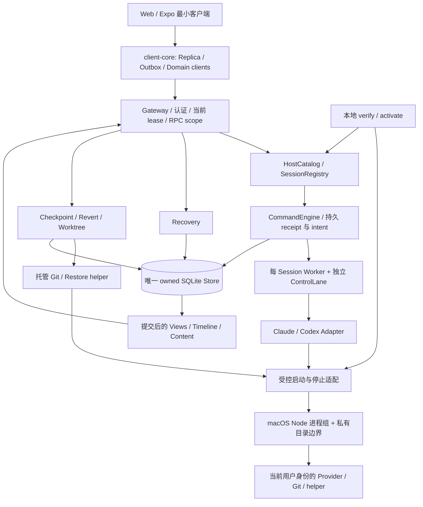

# Flyx 核心能力交付技术方案

> 版本：v1.3.1（普通 macOS 受管执行）
> 日期：2026-10-24（Asia/Shanghai）；初版：2026-10-18
> 状态：**开发进行中（按 G0 → M4 → R4 → R6 → R9 顺序）**。G0 固定源码完整回归已通过（串行全量 1317 passed / 0 failed，指纹一致）；M4 首份生产兼容产物与显式激活闭环已通过（2026-10-24，run-id `m4-final2`：真实 10-turn 场景 → 签名产物 → destination 导入 → activation verify/activate，普通合同下 workspace/provider 双资源激活成功）；R4 真实恢复与备份恢复外部复核已通过（2026-10-24，L1–L4 四层：终态收据锚点 → 恢复检查证据链 → 备份恢复外部复核 → 生产路径端到端恢复链测试并修复 destination endorsement 缺 recovery 能力的生产缺陷）；R6 L1 生产接线已通过（2026-10-24：生产 revert 端口默认构造 + 持久锚点采集接线 + 可信 manifest 门控 capability + nativeFactory journal 绑定，`native-revert-production.ts` 组合测试 fail-closed）；当前项为 R6 剩余真实 Provider 完整回退（A9/A10）；组合终验与物理手机（R9）待验收，检查点和恢复顺序见实施计划顶部。
> 本轮起点：Flyx `003faa3`；本轮改动已全部提交入库并推送（`4af1af5` → `b60852c` → `0bbc950` → `0345f83`，`main` 与 `codex/flyx-optimization` 同点，工作区干净）；历史实现基线：`1108bed`；原分析基线：`c11e08d`；参考快照：Paseo `710851ccb`、T3 Code `4ba4871af`
> 用户已明确：首版必须支持 macOS 本机执行，不能以 Linux Host 替代交付。

本文负责上一轮差距分析后的**剩余核心交付**，作为接下来实施和验收的依据。[原对照方案](./paseo-t3code-comparison-and-optimization-technical-design.md)保留架构背景，[原实施记录](./flyx-optimization-implementation-plan.md)保留 R01–R18 的历史结果。当前进度（M0–M3 与 G0、M4 已实机通过）、剩余任务 R4/R6/R9 的文件范围、实现步骤和证据见[核心实施计划](./core-capabilities-implementation-plan.md)顶部暂停检查点。本文规定最终契约；仅进度表明确确认的范围属于已实施，候选平台机制与剩余接线不因写入方案而视为完成。

## 1. 交付目标与范围

交付一条完整的个人开发流程：

1. 在 macOS 本机配置并验证 Claude/Codex，显式启用对应资源。
2. 从 Web 创建或选择会话，发送任务、接收输出、审批、回答问题和中断。
3. 关闭页面、断网或切换手机网络后，重新读取权威状态，核对原命令。
4. 查看每个 Turn 实际造成的文件变更，并预览和执行可核对的回退。
5. 为独立任务建立隔离 Worktree；独立 checkout 可以并行执行。
6. Host 崩溃、命令回执丢失或回退部分失败后，可以检查原操作并继续处理。

保留现有 Node/TypeScript、Fastify、Zod、SQLite、client-core、Direct/Tailscale 和 E2EE Relay。继续只支持 Claude 与 Codex。现有身份、配对、设备权限、协议协商和有界内容机制作为基础使用。

本轮不加入语音、更多 Provider、任务依赖图、自动 Agent 协作、完整编辑器、通用终端、Git 提交/PR 平台集成或新的云服务。手机仅覆盖核心远控和恢复；完整导航、复杂推送设置与桌面产品包装后置。

首版采用普通 macOS 受管进程组执行；ES 强监督后置。第 4 节与普通执行专题规定当前停止保证及实机验收。

## 2. 已有基础与确定缺口

2026-10-24 更新：普通 backend、生产启动与双 Provider 适配器实测已通过，并已提交入库（`0345f83`，见[阶段验收](./analysis/2026-10-24-macos-managed-execution-acceptance.md)）；停止范围与恢复契约见第 4 节，当前剩余实现步骤与恢复顺序（G0 → M4 → R4 → R6 → R9）见实施计划顶部。本节下表保留历史对照：左两列描述 `1108bed` 基线；中列为 2026-10-23 的逐模块对照结论（详见[实施计划](./core-capabilities-implementation-plan.md) §2–§3、§7 末条），该批改动连同 2026-10-24 macOS 批次均已提交。工作区实现与独立验证持续记录在实施计划 §7，不以基线缺口推断工作区仍完全未实现，也不以新增文件推断已通过生产验收；"已接线"指组合代码存在于生产模块并有定向测试，"实机验收通过"仅限实施计划顶部明确登记的 M0–M3 事项。

| 范围 | 当前源码事实（`1108bed` 基线） | 工作区进展（2026-10-23 对照；连同 macOS 批次已于 2026-10-24 提交 `0345f83`） |
| --- | --- | --- |
| 生产组合 | 已有 Catalog/Views/Interaction/Recovery 等；新增 ActivationLoad、doctor 与 readiness RPC，未构造 HostCheckpoints/HostWorktrees/Scheduler | 强制准入、执行器、Checkpoint/Revert/Worktree/permit/元数据锁中央绑定已在 host-application 接线并有组合级测试（checkpoint port 为首个 domain port）；默认 main 不注入受信 execution 端口，保持 fail-closed |
| 启动/激活 | SQL 历史启动不加载 Provider；维护 CLI、v11 收据与激活加载/失效已实现 | 在线用途 gate 已实现（组合层 `assertNativeReady` 拆分，`restoreWriteReady` 收紧）；实际 supervision/runtime 事实与兼容产物闭环仍缺 |
| 托管查询 | `prepare/execute` 已支持注入 executor；生产 main/Host 未注入，默认仍拒绝 | `ManagedWorkspaceQueryExecutor` 已实现并按 runner 注入；macOS 受管进程组 backend 已接线，生产 main 的在线查询与维护查询统一构造可信端口（M1 实机验收） |
| 进程/Git | 窄句柄、原始记录与受控 runner 已有模块验证；生产 supervisor 分支仍限定 Linux | 每 Turn 停止/续接、全局停止端口、共享关闭 deadline 已接线；mutating Git 套 repository 元数据锁；普通 macOS backend 已实机验收（M0/M3） |
| macOS | 私有目录隔离已测试；全部后代停止、稳定身份绑定尚未成立 | 普通受管执行实机验收通过（进程组清理、双 Provider 真实任务/中断/跨进程续接 2/2）；`treeStopped=false` 诚实标记，ES 强监督后置为可选增强，不再是 C0 门槛 |
| 会话 | Catalog、V2 RPC、独立事件、延迟加载、公开 SessionClient 已有 | Web 新建/命名/归档/关闭运行时与资源选择已接（CoreControls/四面板+真实 Host E2E）；并行状态展示待验收 |
| 恢复 | inspect/reconcile/acknowledge、CLI 和 SDK 已有 | `NativeHistoryReaderFactory` 已注入 CatalogRecovery、restore inspect/confirm CLI 已注册；R4 已通过（2026-10-24，L1–L4：终态收据锚点、恢复检查证据链、签名兼容 manifest 支撑生产 verified 状态、createRestoreExternalInspector 真实外部检查器、生产端到端恢复链测试并修复 destination endorsement 生产缺陷）；Web/手机 Recovery 面板已接 |
| Worktree | journal/typed client 已有，调度器与关闭 fence 模块已验证 | 任务 permit（首版 2）、共享 common-dir 元数据锁、scheduler SQL 扫描修复与中央接线、归档/恢复互斥已实现；生产启用与真并行验收待 runner 注入 |
| Checkpoint/回退 | 服务、受控恢复、journal 与 typed client 已有 | Checkpoint 中央组合（固定顺序捕获+projector v4 白名单投影）已接线；双 Provider 回退驱动与响应丢失 unknown 语义完成（仅 fixture），生产接线与真实回退待做 |
| 客户端 | 草稿、Outbox、权威副本、引用读取、审批、最小 Expo 平台已有 | CoreControls/Web 四面板/手机最小面板已接通（真实 Host E2E 覆盖会话元数据/草稿/readiness）；剩余 Recovery/Diff/Worktree/Revert 浏览器 E2E 与真机验收 |

核对入口：[Host application](../apps/mvp-host/src/host-application.ts)、[查询执行器](../apps/mvp-host/src/lifecycle/managed-workspace-query.ts)、[Catalog](../apps/mvp-host/src/catalog/host-catalog.ts)、[macOS 实测](./macos-native-stop-contract.md)、[查询契约](./managed-workspace-query-contract.md)。

初版设计时（2026-10-18）曾观察到 43 项定向验证中 36 通过、7 项超时及 Worktree 清理报错；这是历史观测，不直接代表当前缺陷数。后续已完成 `HostWorktrees.seal()` 幂等 fence 与相关模块验证。2026-10-22 进展核查另有 9 文件 / 58 用例通过，覆盖 C1/C2、调度器、C3 和迁移；没有新增真实 Provider、完整产品套件或手机验收。历史全量、定向重跑与当前生产验收的适用范围分别见实施计划 §5–§6。

## 3. 固定架构与所有权



固定所有权：

| 对象 | Owner | 生命周期 |
| --- | --- | --- |
| SQLite writer、Host 身份、Views、Gateway、全局恢复与 Git 服务 | Host application | 启动至最终封闭 |
| Provider adapter、对应控制通道 | Session runtime | 显式开始任务时加载，显式关闭或 Host 关闭时结束 |
| checkout 写权限 | WorkspaceLease | 原 operation/attempt 持有；未知停止继续保留 |
| Provider/Git/helper 原始启动 | 受管 launch 记录与 Engine dispatch context 联合绑定 | 从派发前记录到独立停止证明 |
| 草稿、待核对命令、显示缓存 | 应用级 client-core runtime | React 卸载不关闭远程任务 |

基础约束：命令受理、原生交付、业务终态、生产进程停止、工作区放行分别记录；不能互相推导。SQL 事务不覆盖 Provider 或文件系统副作用。外部网络调用、远程服务、已触发的系统副作用也不属于文件回退的保证范围。

沿用 T3 的事务决策、提交后副作用、可排空 worker 思路；沿用 Paseo 的持久会话与按需加载分离。Flyx 已有对应实现，本轮直接复用，见参考 T01/T02/P01。

## 4. macOS 平台契约：普通受管执行

2026-10-24 用户已明确选择普通受管执行。此前 ES 监督服务的强停止闭包设计不再作为首版 C0 门槛；完整新契约、状态、恢复规则与验收见 [macOS 普通受管执行](./macos-managed-execution.md)。旧探针与 [监督契约审查](./analysis/2026-10-22-macos-supervisor-contract-review.md)保留为强保证边界证据，不将其结论改写成普通模式通过。

### 4.1 保证与范围

普通模式管理本项目启动的根进程及进程组，记录原始启动和退出，SDK 中断后进行有界 SIGTERM/SIGKILL 清理。主动脱离组的后台后代、外部服务和远端副作用不属于完整停止保证。私有目录边界、原始启动记录、当前权限和工作区互斥保持。

### 4.2 停止语义

新增 `managed-process-group/v1/darwin` 与 `managed-group-stop`，绑定原进程身份、launchDigest、processGroup、根退出和组不存在观察。`stopped` 表示原启动的契约满足；普通模式 `treeStopped=false`、`verifiedDescendantStop=false`。`verified-tree-stop` 继续仅表示完整后代隔离停止，不能复用为普通清理结果。

### 4.3 C0 门槛

C0 改为目标 Mac 上受管启动、私有目录保护、进程组清理、超时/异常 unknown、原始 journal、生产接线及双 Provider 真实任务/中断/跨进程续接验收。ES entitlement、Developer ID 与系统服务安装授权从首版依赖移除；桌面分发签名另行安排。

### 4.4 恢复与放行

只有与原 owner/attempt/launch 关联且通过相应契约验证的停止记录，才可参与 after checkpoint、checkout 放行与恢复。旧 macOS 记录没有普通合同或停止观察时仍 unknown，不迁移补造。inspect/reconcile/acknowledge 继续要求 Native 历史、checkout clear、当前授权和 revision/CAS；用户确认、SDK interrupt 或新激活不能代替停止记录。

### 4.5 异常与范围反例

组检查错误、超时、spawn/PID 持久化失败或已知外部写入者均保留 unknown/lease。根退出后仍存在的原进程组也需清理。逃逸探针保留为普通模式的已知限制，不宣称证明了全部逃逸后代停止。ES 后端未来若实现，独立验证其更强契约。

## 5. 统一受控执行：Provider、Git 与 helper

### 5.1 接入现有端口

复用 `ManagedProcessRegistry`、`SqliteProcessJournal`、`HostManagedRuntime` 和原始 DispatchContext。复用 Node 启动适配，在这些对象中新增普通进程组停止契约。Linux 实现保留原路径；首版验收仍必须包含 macOS。

原先 `ProviderExecutionBoundary.spawn()` 与 stdio client 依赖 Node `ChildProcess`；当前已改为 `ManagedChildHandle`，Claude SDK 通过锁定 facade 满足 `SpawnedProcess`。Node 适配已验证，普通 macOS 契约与生产接线已实施并通过实机验收（M0–M3，见[阶段验收](./analysis/2026-10-24-macos-managed-execution-acceptance.md)）；不能用类型断言把 IPC 句柄伪装成原生 ChildProcess。

固定接口：`ManagedChildHandle` 只暴露各调用方真正使用的 stdin/stdout/stderr、exit/error 事件、原始 root PID、取消请求和关闭等待。剩余改造在同一接口上接入普通受管执行，并验证实际 stream/取消/关闭语义；不重做已通过的 Node 路径。

Claude 的同步 spawn 回调复用 Node ManagedChildHandle facade：先提交 launching，再实际 spawn 并保存原 PID/观察；返回 facade 后才由 SDK 交付 stdin。普通模式不声称有内核级启动屏障；spawn 到身份持久化之间崩溃时保留 launching/unknown。准备失败必须发 error，不能伪造 PID、成功 spawn 或正常 exit。stderr、EOF、abort、背压和 SDK 关闭顺序分别回归。

### 5.2 托管 Git 的统一入口

已新增 `lifecycle/managed-git-runner.ts`，适配以下三类用途并保留各自 allowlist；macOS backend 与生产 main 的中央注入已完成（M1：在线查询与维护查询统一构造可信端口），剩余交付为真实恢复/回退场景的消费端实测复核（R4/R6）：

| 用途 | 现有输入 | 权限和资源 |
| --- | --- | --- |
| 工作区身份查询 | `WorkspaceGitQuery` | 固定两条 rev-parse、只读策略、最多 16 KiB/5 秒；不推导普通 Native 能力 |
| Checkpoint/对象读取 | `HostCheckpointGitRunRequest` | 冻结最终请求、checkout 身份、capture/operation 绑定和内容预算 |
| Worktree/Restore 变更 | WorktreeExecutionContext / Restore step | 精确步骤、原始/后继 attempt、checkout lease 和必要 repository 元数据锁 |

统一执行顺序：输入校验 → 实际路径/二进制/策略校验 → 持久 launching → Node spawn 与原 PID/观察持久化 → 有界输出 → 所选合同的停止记录 → 提交结果。每个 helper 也属于生产进程，不能因“只是 git --version”而跳过记录。

`RawWorktreeGit`、`ControlledRestore.verifyRepository/objectGit` 和旧 `GitService` 的生产端口已要求注入 runner；确定性 fixture 可保留显式 raw 实现。中央组合的注入已在生产 main 完成（M1）；`SessionRegistry.gitStatus/gitDiff` 等剩余调用方复核与真实恢复检查随 G0/R4 推进。生产构造器缺 runner 时继续拒绝，不能静默走测试 fallback。

最终 argv/env/cwd、stdin 摘要、执行预算和 DispatchContext 必须在派发前固定。禁用用户 Git hooks、fsmonitor、external diff/textconv、隐式网络取对象及继承的 Git 配置；工作区查询和变更使用不同策略，不能复用一个无限制 shell runner。

临时 index/object/worktree 目录同样先做真实路径规范化，再冻结到请求。macOS 的 `/var/folders` 与 `/private/var/folders` 别名不能由 runner 放宽校验来迁就；生产者应传入 canonical 路径。异常也保留原 processId、launchDigest、用途、操作/步骤与请求绑定，不能在 Git driver 中包装成丢失停止状态的普通错误。

### 5.3 首版进程驻留策略

为使停止证明与 checkout 放行一致，首版将实际 Provider 进程树归属到单个 Turn attempt。业务终态后关闭该 attempt 的受管 Provider/工具进程组，核对已登记生产者，再捕获 after checkpoint；下一 Turn 使用持久 NativeHandle 按需重启并续接对话。Claude Query 和 Codex app-server 都必须验证这一进程边界；不能将常驻 Codex peer 的 ready/idle 当成全部后代停止。

任务启动的后台进程随该 attempt 关闭，长期开发服务不在首版后台保留范围内。Session runtime 可以保留轻量控制对象和历史绑定，不保留仍能写 checkout 的闲置负载。版本/历史查询和 Revert 各有独立受控 attempt。验收必须包含跨进程重启后的对话连续性，而不能只验证同一 app-server 内连发消息。

## 6. 本地验证、兼容证据与显式激活

### 6.1 保持历史启动

普通 `start` 继续先开放历史与恢复查询。配对、页面打开、会话选择和读取 Timeline 不启动 Provider，也不触发付费预检。

当前已接入维护模式的本地 CLI。构建后由实际 main 调用，参数以 `activation-cli.ts` 为准：

```sh
rtk proxy node apps/mvp-host/dist/main.js activation verify --workspace <registeredId> --provider <instanceId> --command-id <verifyCommandId>
rtk proxy node apps/mvp-host/dist/main.js activation activate --evidence <verifyOperationId> --command-id <activateCommandId>
rtk proxy node apps/mvp-host/dist/main.js activation inspect <operationId>
```

上例尖括号表示占位参数，运行时应替换为实际 ID；当前仓库尚无 `flyx` 可发布命令。`verify` 只匹配已有兼容证据并检查资源，不运行模型场景；缺实际查询后端/运行事实时拒绝并保留收据。CLI 能解析和记录拒绝不等于资源已经能够成功激活。

首版在 Host 停止、持有 maintenance owner 时验证和激活；完成后正常启动。这样不新增一个远程管理写入口。不能启动第二个 writer，也不能通过 SQL 手工把 verification 改成 verified。读取普通 doctor 继续不产生副作用。

维护 CLI 已直接调用 `HostActivationService` 和管理操作 Store，不构造运行态 HostCatalog，也不调用当前只接受 host owner 的 `revalidateConfiguration()`。真实兼容任务在独立 fixture Host 中执行；生产库中的管理/helper 记录使用 `ProcessLaunchContext` 可选 Session 字段，不创建假的用户 Turn。

### 6.2 拆开三种证据

| 证据 | 内容 | 可以证明 | 不能证明 |
| --- | --- | --- | --- |
| 平台后端证据 | 当前 OS/kernel、运行后端身份、策略和停止契约 | 当前后端满足已验证契约 | 某一次原始 launch 已停止 |
| Provider 兼容证据 | 实际 executable/SDK/adapter/runtime/Node、场景结果 | 该版本组合支持已测试能力 | 任意版本、当前 checkout 或未知原尝试可放行 |
| 当前资源激活 | canonical checkout、配置/策略版本、已验证版本引用 | 当前资源满足开始新命令条件 | 恢复或备份 restore gate 已解除 |

原始进程停止证明单独保存在执行/恢复记录中，不受激活缓存替代。

### 6.3 消除验证启动循环

兼容 runner 在独立临时 Git 仓库、独立 Store/identity 中运行固定任务，使用受控验证入口；它不要求先激活用户的生产 Session。真实 Provider 调用由专用兼容/验收命令显式触发，沿用 `--real` 与对应 `RUN_REAL_<PROVIDER>=1` 双条件；`activation verify` 消费已有产物，不隐含付费调用。

产物分别记录 turn、approval、question、interrupt、reconnect、recovery、rewind 的实际支持和结果；不支持的可选能力明确标记。Claude 与 Codex 均有验收行。不能将版本查询或一条 OK 回复升级成全部能力验证。

接通 `run-matrix.mjs` 的实际 readiness 产物与 `CompatibilityEvidenceRecorder`，补 Recovery 场景调度；`fully-verified` 由原始记录推导，拒绝仅修改矩阵状态。证据位于 Host 私有目录，使用规范化内容摘要及 Host 身份签名；签名用于校验来源和完整性，不能代替场景测试。

当前 recorder 与真实 adapter/recovery 尚未组合，真实 main 也未写 runner 期待的 readiness 文件。补齐时，受限本地验证模式应以 runId、构建/入口、Host 身份、观察版本绑定原子写入的私有握手文件；不导出到公开 RPC，不用旧文件或测试入口冒充生产 main。验证入口只接受固定隔离场景与已验证后端，不提供远程绕过激活的通用开关。

本轮细化为以下有界流程，相关模块与 CLI 正在集成，尚不代表真实验证已通过：

1. `run-matrix --prepare` 在独立私有目录生成 source identity、runId 与构建准备信息，不调用 Provider。
2. 生产 Host 停止后，由 maintenance CLI `compatibility authorize` 对独立 source 公钥、runId、Provider、构建/运行时/产物摘要和固定场景集签发短期授权。source Host 与生产 Host 身份不同，不能直接要求二者 fingerprint 相同。
3. source main 验证授权及真实环境后，构造不对 RPC 暴露的 `CompatibilityScenePolicy`。它只允许该隔离 Session 的固定基本 prompt 和十条确定 commandId；受理在原 Engine 事务内持久保留，派发/实际 spawn 再核对原请求与 DispatchContext。只豁免“尚无旧兼容证据”的循环依赖，不豁免 owner、当前设备、restore、Recovery、checkout lease、真实进程边界或停止证明。不能永久把资源改成 activated，也不能仅凭 env 令 `assertNativeReady` 成功。
4. 原启动前保存冻结的 executable/script/Node/Host build/配置测量，与原 processId 和 launchDigest 绑定；planned snapshot 不是内核执行映像证明。记录成功场景还必须核对真实 Native binding、已提交原生终态事件及原进程停止证据，不能只检查非空引用。Claude 使用真实 result UUID，Codex 使用真实 native Turn ID，不互相伪造。
5. 专用 `--real` 命令仍要求相应 `RUN_REAL_<PROVIDER>=1`，运行后导出 source 签名 readiness、逐场景记录和原来源摘要；fixture/deterministic 签名域不能进入生产信任链。
6. maintenance CLI `compatibility import` 核对预先签发的授权、原 source、run/build/场景与精确记录摘要，生成生产 Host 签名的 endorsement。激活消费该 endorsement，缺失时拒绝；自带公钥的自签名产物本身不建立信任。`activation verify` 不自动导入或运行模型。

首个基本场景只发布实际完成的 `turn` 能力；审批、Question、中断、恢复、回退分别需要相应场景与真实证据，不能通过 import 给未运行能力背书。十次唯一成功按 Provider 的真实结果身份去重，不按客户端调用次数计数。

能力验收随实施推进：C3 先验证任务/续接/审批/Question/中断/停止，C4 再加入真实恢复，C6 再加入完整回退。产物记录场景集版本和逐能力证据；`fully-verified` 只针对该产物声明的固定场景集，未完成能力不发布。这样 C3 不会反过来依赖尚未实现的 C4/C6，已验证的基本执行也不会被展示为回退已交付。

当前资源激活步骤：

1. 验证 owner、原始未决生产者、restore gate；任何未解决的原始写入都保留阻塞。
2. 通过托管 query 验证 canonicalRoot、checkoutRoot、git common dir 和目录身份；检查私有目录不重叠。
3. 验证实际 Provider executable、SDK、adapter、配置指纹和受管执行契约，匹配真实兼容产物。
4. 在一次短 SQL 事务中，CAS 校验资源版本并更新工作区/Provider readiness，记录激活证据 ID。
5. 启动时重查资源绑定、二进制/配置/策略摘要、证据有效期与后端 readiness。匹配则加载当前就绪状态；不匹配只读启动并展示原因。

实现需拆开 `registerCatalogReadMetadata` 里“登记身份”和“无条件失效”的职责。旧证据不会因为读取历史被抹掉；变化、过期和无法核对则使激活失效。不得在启动中自动重新执行真实兼容场景。

兼容证据默认有效期为 24 小时，作为待实测的 Host 本地配置；输入摘要变化立即失效，不等过期。有效期只能决定是否重验，不能替代每次原始执行的监管。维护模式没有未决 producer 且源绑定未变时，`activate` 才能完成；否则保存具体阻塞原因。

## 7. Gate、命令与关闭顺序

### 7.1 按用途校验

将当前大范围 `assertBusinessReady()` 拆为少量明确函数，挂在已有服务边界，不建立新的通用策略引擎：

截至 `1108bed`，该拆分和在线激活强制尚未完成：现有 admission 只执行原 producer/restore 等 gate，`HostActivationService.assertReadyForWrite` 没有在线调用。实施必须复用同一 observation/load 的断言与撤销逻辑，不能因当前环境无法激活而把这个缺口作为最终行为保留。

| Gate | 适用 | 条件 |
| --- | --- | --- |
| history | SQL 历史、已保存回执、证据读取 | schema/权限可读、Store 未封闭 |
| new-command | startTurn、新 worktree/revert 等 | 当前授权、Host admission、该用途所需资源/后端验证、无相关原始 gate、当前 lease；Native 要求 workspace/provider 激活，纯 Worktree Git 不要求无关 Provider 激活 |
| accepted-continuation | 已受理操作的下一步骤 | 原 operation/attempt、当前权限、原资源、有效 lease 和独立 restore 条件 |
| recovery | inspect/reconcile/acknowledge | 原目标身份、当前权限、证据版本；不能要求目标已经恢复为 idle |
| metadata-write | rename/archive/create 等 | 当前权限和必要资源条件；不随意加载 Provider |

已受理 Revert 不能被自己建立的“有操作进行中”gate 阻止。例外必须绑定该 operation 与步骤，不能用全局 `bypass` 标志。

新命令在受理前和实际副作用派发前分别复核，排队不能延长旧证据效力。尚未交付的 prompt 仍按新 Native 命令检查。中断/取消保留原 attempt 的独立控制路径，激活过期不能使停止不可用；审批/Question 继续核对当前权限、版本和原控制通道。详细接线与拒绝矩阵见实施计划 R2。

保留 CommandEngine 的 receipt/event/intent 原子事务和提交后 worker 派发；保持 ControlLane 独立于长任务完成等待。支持当前权限重查，设备撤销后未交付的审批不能继续发出。无原生确认的响应只能显示“已受理/待核对”。

### 7.2 有序关闭

统一将 Host 内部期限命名为绝对单调 `deadlineAt`；现有接收相对 `deadlineMs` 的接口通过适配转换，避免重复延长总期限。跨进程 IPC 只传剩余预算 `remainingMs`，接收端换算为自己的单调期限，不能直接比较不同进程的 `performance.now()`。

1. 封闭新命令与新 launch admission，处理未派发 intent。
2. 在 `stopProducers` 阶段发起 Provider、Git、Restore helper 停止；不能先等待所有 operation 完成才停止 Git。
3. 等待已受理控制/恢复及允许完成的步骤；限定 deadline。
4. 提交明确结果或 unknown，保留未停止资源所有权。
5. 同步封闭 runtime/driver/Views/设备/传输的迟到 callback；这一步不依赖 drain 成功。
6. 关闭连接与 Store。原始未决 launch 继续保留在私有 journal 中，未取得停止记录时保持 unknown。

`HostWorktrees.seal()` 已改为幂等的同步 callback fence；不因 running/calls 未清空而在封闭前抛错。它不宣称 producerStopped，也不释放 lease。原始拒绝/未知结果应在关库前记录，关库后回调只结束本地 Promise，不写 SQL 或发布事件。

剩余中央接线需补上全局 Git/helper 的显式停止阶段：当前 `CatalogGlobalService` 仅有 drain/seal/close，Host 的 `stopProducers` 主要等待 Session runtime 关闭。新增最小停止端口或固定 runner 接点，必须先发停止再等待 operation/service drain，不能只把 Worktree/Checkpoint 加入 drain 列表。

## 8. 原始恢复与备份恢复

### 8.1 原始执行恢复

继续使用现有 `RecoveryClient` 和三种 RPC：

```text
session.recovery.inspect
session.recovery.reconcile
session.recovery.acknowledge
```

完整调用链：

1. 读取指定 Session/Turn/attempt 的原 receipt、dispatch context、NativeHandle、所有原始与后继进程。
2. 从可信兼容产物校验原 Provider 历史格式与检查能力。
3. 查询原 supervisor launch 和 checkout 身份；缺失只能返回 unknown。
4. 在原生状态可读时核对真实终态、当前工作区和未决交互。
5. 保存 evidenceId、recoveryRevision、原资源摘要及有效期。
6. 用户选择允许的动作；重查当前权限、证据新鲜度和原资源，CAS 提交。
7. 在同一业务提交中更新恢复 gate、相关 receipt/intent、交互 supersession 和投影；随后读取权威快照。

`reconcile` 只提交可证明的结果；`acknowledge` 允许用户接受“业务结果仍未知”，但仍要求停止和 checkout 放行证据。二者均不重跑原命令，不把“用户确认”当成进程停止证据。

界面直接消费现有 `RecoveryEvidence.nextSteps`，不自行由三个状态布尔组合生成动作。保存原 evidenceId 与 expectedRecoveryRevision；过期或 `RECOVERY_EVIDENCE_STALE` 时重新 inspect。`acknowledgeUnknown:true` 只在用户明确选择该动作时提交。

### 8.2 原生历史检查端口

当前 `CatalogRecoveryOptions` 只有可信 manifest 和 existing Codex reader 注入点；生产组合未补齐。新增一个用途固定的 `NativeHistoryReaderFactory`，允许：

- 使用已存在、绑定正确且受管的连接；或在显式恢复操作内启动受控 inspection-only helper。
- Codex allowlist 仅包含所需的 `thread/read` 等已验证只读查询；禁止偷偷发送 prompt 或恢复原 Turn。
- Claude 读取原生 transcript 与锚点，不修改 transcript，不靠搜索“completed”字样裁决。
- helper 自己也需要原始启动与停止证明，不能在 inspect 结束后留下无主进程。

Native/helper 检查结束后再读取原执行停止事实；检查超时、构造拒绝或停止未知均阻止 acknowledge 放行。新检查 helper 不得伪装成旧 owner 的原始 launch；它以单独的、绑定原操作的已验证后继清单进入检查证据。inspect 与确认期间新增的同 owner 检查 helper 也要逐一验证、持久关联，不能因为使用新 helper ID 就永久使原业务结果无法核对；不在该清单中的 owner journal 变化继续判 stale。

公开历史查询仍不构造 Native。只有显式恢复可触发上述有界检查。原生状态打不开或版本不匹配时显示当前能证明的事实和阻塞原因。

离线恢复统一使用原始 `checkoutRoot`；Provider 的子目录 cwd 只用于定位历史，不能代替 lease 的 checkout 根。

### 8.3 备份恢复后的外部复核

沿用 `restore_readiness`，新增本地 `restore inspect-state` / `restore confirm-state` 语义，在 maintenance owner 下完成：

1. 核对 backup/identity/DB/content 完整性及恢复范围。
2. 根据原 supervisor 日志盘点备份后可能发生过的生产者与命令。
3. 核对当前 checkout、hidden refs、Provider 历史与数据库原绑定。
4. 对未决原操作分别执行恢复；不存在的 receipt 不作为未执行证明。
5. 生成有版本和快照摘要的检查证据，确认时重新核对并写入审计结果。

只有复核通过才解除全局 restore gate；Session 自身的未知执行、Worktree/Revert gate 仍分别判定。若备份缺失期间操作无法确定，只能保持相关资源阻塞或另建显式的新工作区/会话，不能自动把旧 checkout 放行。

## 9. 会话与 Worktree 核心流程

### 9.1 会话入口

Web 使用现有公开 `SessionClient` 接通 workspace/provider 列表、新建、重命名、归档、取消归档、关闭运行时及分页。会话保留创建时的 Provider/workspace 绑定；“改用 Codex”创建新会话，不改写已有 NativeHandle。

列表展示活动、待交互、恢复阻塞和归档状态。关闭运行时与归档独立；进行中的任务按现有状态规则先停止或拒绝，不能用归档替代停止。

### 9.2 隔离任务创建

复用 `worktree.create` 和 `session.createNew`，保持两个有独立回执的操作：

```text
选择已登记 repository/ref
  → worktree.create（持久受理）
  → 托管 Git 执行并发布 workspaceId
  → session.createNew（指定 workspaceId/providerInstanceId）
  → 选择新 Session
  → 显式发送任务
```

第一个步骤成功后客户端崩溃，可以从原 Worktree operation/receipt 找回 workspace，再继续创建会话。会话创建使用与该流程绑定、持久保存的 commandId；回执未知先查询，不自动创建第二个 Session。两个步骤不伪装成跨文件系统与 SQL 的单一原子事务，也不新增通用任务编排表。

首版分支使用现有生成规则；不增加 PR checkout、任意目标目录、仓库远程克隆或自动 setup scripts。

### 9.3 并行和锁

- 每 Session 至多一个活跃 Turn，复用现有约束。
- 同一 canonical checkout 的写命令互斥，包括任务、回退、归档和恢复。
- 独立 worktree checkout 可各自运行；初始并发上限为 2 个实际执行任务，作为待实机验证的配置默认值。
- git common directory 的变更另有短期 repository 锁，覆盖 worktree 注册、ref 更新等共享元数据；不持有它等待整个 Provider Turn。
- repository/checkout 多资源锁按固定顺序获取；读查询不能借机升级写 lease。
- 保留当前各 Session Worker，仅对 Worktree operation 进行有限调度；不新增依赖图或跨 Agent 调度平台。

并发上限通过 Host 内一个有界 permit 实现，不新增持久 job 表。已受理任务等待 permit/checkout lease 时仍是 queued；取得两者后才能提交 dispatching 并交付 prompt。审批、中断和恢复控制不等待普通任务 permit。关闭期间未派发等待项按原 intent 明确取消或留待显式核对。

当前 WorktreeScheduler 的有界并发只覆盖 Worktree operation 模块，不是所有 Provider Turn 的 Host 上限；中央实例化、任务 permit 与共享 Git 锁仍属于剩余交付。

具体接入一个 Host 级 `WorktreeScheduler`：`accepted` 回调只在提交后唤醒，扫描可派发的持久 pending intent；调用现有 `HostWorktrees.dispatchAccepted(intentId)`，由它执行唯一 claim/dispatch CAS。该 scheduler 不加载 source Session 的 Provider，也不再做一遍 claim。只处理当前 owner/generation 下未派发的固定 Worktree 方法；旧 owner 的 claimed/dispatching/unknown 转恢复检查。启动扫描与提交后唤醒共同避免丢失内存唤醒；关闭先封闭扫描和停止 Git。保留 `assertSourceIdle` 对本操作原始/恢复 binding 的精确排除，其余 intent 仍阻塞。

归档先停止所有指向目标 checkout 的运行时，检查未决操作，再保存 staged/unstaged/untracked 状态和保留引用。恢复仍使用原 worktree 绑定；未知 Git 步骤通过 reconcile/resume，不重建同名目录覆盖已有文件。

借鉴 Paseo 的 Worktree 创建意图与结果分离（P03）；原路径 lease、journal 和恢复沿用 Flyx 自己的实现。

## 10. Checkpoint 与精确 Diff

### 10.1 生产组合

在全局 Catalog/Views 建立后创建一个 `HostCheckpoints`。为每个 Session runtime 注入其 `executionBinding`，在 Worker 启动前调用 `bindWorker()` 注册 Revert handler。`runtimeState`、`leaseForContext`、`captureStateFor` 均由当前实际运行时和 lease 提供；客户端不能构造这些事实。

流程：获取 checkout lease → 记录 intent → captureBefore → 派发 Provider → 提交业务终态 → 证明相关生产者停止 → captureAfter → 发布 Diff 可读状态 → 放行 checkout。

用于“可审阅任务”的首版默认要求有效 before capture；失败发生在 prompt 交付前，任务不启动。after capture 失败不改写已知 Provider 业务终态：显示 Diff 不可用或 raced，保留捕获失败事实。是否允许后续任务取决于 helper 已停止、相关执行 gate 已解决和新 before capture 可用；不能将一次 Diff 失败永远等同于业务结果未知。

### 10.2 捕获语义

- 工作树与真实 index 独立保存，使用临时 index 和 hidden refs；不修改用户暂存区来生成 Diff。
- 保留原始文件内容、权限、删除、rename、symlink、untracked 和 binary 的可支持状态。
- ignored 文件、特殊文件、子模块、超预算对象等按现有能力明确报告；不把未覆盖内容展示成完整 clean。
- 外部编辑导致采样变化，标为 raced；只有稳定的 before/after 才用于精确回退。
- 历史缺锚点或只有 legacy baseline 的记录保留 `legacy_inexact`，不补造精确归属。

Web 通过 `checkpoint.getTurnDiff/getSessionDiff/getFile` 分页读取；文本提供按文件展开与基础高亮，二进制提供大小/摘要与支持状态。大正文继续通过现有 ContentRef 校验读取。手机先提供文件列表与单文件 Diff，不引入编辑器。

具体 hidden-ref/临时 index 的参考是 T3 `GitVcsDriver` 与 `CheckpointStore`（T03），应用层继续复用 Flyx 现有 CheckpointService。

## 11. 分阶段回退与 Provider 对话

### 11.1 沿用已有操作模型

继续使用 `NativeRevertDriver.prepare/apply/query`、RevertService journal、preview CAS 和 safety checkpoint：

```text
validated → safety_captured → workspace_restored
          → provider_rewound → projection_committed
任一步骤无法证明结果 → partial_failure / blocked
```

预览绑定 actor、Session revision、checkpoint、workspace/index 摘要、原生锚点、epoch 和过期时间。执行前再次检查；预览后外部改文件、切分支或换 Native 会话均要求重新预览。

每个外部步骤先持久 `dispatching`，执行后记录 applied/unknown。重启只检查原步骤；不能自动重发 `thread/rollback` 或再次 fork 会话。

### 11.2 两个 Provider 分别实现

| Provider | 候选机制 | 实现要求 |
| --- | --- | --- |
| Codex | 参考 T3 的 `thread/read` 与 `thread/rollback(numTurns)` | 将 Flyx Turn 映射到真实 Native Turn 边界；保留目标历史摘要；响应丢失后只读核对，不能再次减少 numTurns |
| Claude | 参考 Paseo 的 `forkSession(upToMessageId)`，保留原会话分支 | 持久真实消息锚点，验证边界是否包含目标消息；成功后原子更新 Flyx 绑定；受管 helper 完成 SDK 历史操作 |

T3 的 Claude `rollbackThread` 主要调整自身 turns 和恢复游标，不能直接作为 Flyx 已持久回退的证明；Paseo 的 `rewindFiles` 也不能代替 Flyx 对 staged/untracked/原始文件的捕获和恢复。两者用于具体映射参考（T04/P04），不整体复制。

每个 Turn 至少保留可核对的原生会话、Native Turn、必要用户/assistant 消息锚点以及 before/after 对应关系；私有信息不进入公开 Session DTO。锚点来自实际事件与历史，不能靠 Flyx Turn 序号推测 Native 偏移。

`apply` 没有原生幂等键且响应丢失时，`query` 必须能证明目标边界，否则返回 unknown。版本已验证只表示机制可用，不表示当前操作已经应用。prepare 阶段可以报告 unsupported；不能为保持按钮可用而虚构 conversation-rewind 能力。

### 11.3 文件恢复与完整回退分开

`checkpoint.executeRevert` 恢复文件与对话；仅在两部分均有实际能力和证据时开放。`checkpoint.workspaceRestore` 明确只处理文件，旧对话仍需显式分叉/新建会话或继续维持相应 gate，不能标成完整回退。

部分失败页面展示已完成阶段、未知阶段、当前阻塞原因及允许的 inspect/resume/rollbackToSafety。回到 safety 也使用独立步骤与证据，不能删除 operation 冒充从未发生。

成功提交同时更新 NativeHandle、相关 Session 状态、交互 supersession、Timeline 新 epoch 与引用 pin；旧历史保留可读，现有 Replica 按 epoch 重开视图。

## 12. Web 与手机最小操作闭环

### 12.1 Web 页面职责

将当前 `app.tsx/use-host.ts` 的展示与以下小控制器拆开，复用 client-core 的 domain client：

| 面板 | 操作 | 关键状态 |
| --- | --- | --- |
| Host/资源状态 | 显示激活/平台/恢复原因；提供本地处理指引 | 可读、可执行、待核对分别展示 |
| Session 列表 | 新建、选择、命名、归档、关闭运行时 | 分页、selected、busy、blocked、archived |
| Timeline/Interaction | 输出、按需正文、审批、Question、中断 | 当前权威副本、版本和权限 |
| Recovery | inspect、允许的 reconcile/acknowledge、只读回执查询 | 原 attempt、证据过期、请求受理/结果未知 |
| 变更 | Turn Diff、单文件、preview、执行回退 | complete/raced/unsupported/legacy_inexact |
| Worktree | 创建、查询进度、归档、恢复及未知操作核对 | 原 operation/receipt、checkout 归属 |

不让组件自己创建 socket、轮询未知命令或推断成功。所有写操作经现有 durable Outbox；未知结果只读查询。切换 Host/Session 时，使用 selection/transport/replica generation 丢弃旧响应；草稿与原 commandId 保留。

Recovery 操作后的成功以新权威快照为准；不可在按钮点击后本地把会话改成 idle。手机提醒点击也只定位当前 Session/Interaction，不执行缓存审批。

### 12.2 手机首版范围

保留现有扫码/深链、SecureStore、SQLite、NetInfo/AppState 和 Noise 适配，完成配对、会话选择、发任务、审批/Question、中断、回执核对、Recovery 和只读文件 Diff。

手机 Worktree 首版可以选择已创建工作区；复杂归档/回退的首次交付由 Web 完成。Host 能力通过同一协议暴露，手机后续接 UI 不修改执行语义。推送只验收已有最小提醒与安全跳转，不建设新通知平台。

## 13. RPC、数据与版本迁移

### 13.1 复用与新增边界

| 类别 | 契约 |
| --- | --- |
| 复用 | Session V2、Interaction/Question、Recovery、Checkpoint/Revert、Worktree 现有 RPC |
| 新增只读 | `host.getExecutionReadiness`：资源 ID、能力、reasonCodes、当前证据摘要与需要本地处理的步骤 |
| 本地管理 | verify/activate、restore 外部复核；首版不开放远程配置/可执行文件/任意 cwd |
| Native 内部 | Supervisor 协议与各 Provider 原生回退/只读检查；不直接映射成公网 RPC |

拟新增 `host-execution-readiness-v1` capability。公开结果按请求列出的资源 ID 返回，每次最多 50 项；不输出私有路径、Native ID、argv、token、root supervisor 日志。权限为 `host:read` 加对应资源可见性，复用 Gateway 当前 lease/transport generation 校验。建议 DTO 如下，实际 Zod schema 采用 strictObject 并限制字符串、数组大小：

```ts
type ExecutionReadinessRequest = {
  targets: Array<{ workspaceId: string; providerInstanceId: string }>;
};
type ExecutionReadinessResponse = {
  v: 1;
  generatedAt: string;
  hostState: "read_only" | "ready" | "draining" | "recovery_required";
  reasonCodes: string[];
  targets: Array<{
    workspaceId: string;
    providerInstanceId: string;
    resourceRevisions: { workspace: number; provider: number };
    capabilities: string[];
    reasonCodes: string[];
    evidenceId?: string;
    validUntil?: string;
  }>;
};
```

resourceRevisions 分别来自两个资源新增的 readiness_revision；更新和失效都递增，不复用某个无关 Session 的 revision。响应是 UI 提示快照，每次执行仍由 Host 重新检查；也不将 capability 字符串直接当成权限。

旧客户端继续读取历史；未协商新 capability 时不展示新操作。已有 capability 只在实际服务组合且当前条件成立时发布，不能仅凭表存在或 factory 可构造启用。每个 Session 的 rewind 支持另外查询，避免全局一刀切。

### 13.2 最小数据库变更

继续使用原 schema 010 中的 Session/Catalog、receipt/intent、process evidence、Recovery、Checkpoint/Revert/Worktree 表；中央迁移 **011-execution-activation** 已合入，当前 schema 为 v11，不在 factory 内执行 DDL。

011 已安装以下本地管理操作表，承载 activation 与后续 restore 外部检查，避免为每个步骤另建框架：

```sql
CREATE TABLE host_execution_operations (
  id TEXT PRIMARY KEY,
  actor_id TEXT NOT NULL,
  command_id TEXT NOT NULL,
  kind TEXT NOT NULL CHECK(kind IN ('activation','restore_check')),
  request_hash TEXT NOT NULL,
  state TEXT NOT NULL CHECK(state IN
    ('accepted','checking','ready','completed','rejected','outcome_unknown')),
  revision INTEGER NOT NULL CHECK(revision >= 0),
  owner_context_json TEXT NOT NULL,
  resource_binding_json TEXT NOT NULL,
  evidence_json TEXT,
  result_json TEXT,
  created_at TEXT NOT NULL,
  updated_at TEXT NOT NULL,
  UNIQUE(actor_id, command_id)
);
```

该表同时是本地管理回执；同一 actor/commandId 的请求摘要必须相同。细粒度进程仍写现有 managed_processes，不把管理操作伪装成用户 Session Turn。完成激活的资源状态变更、相关证据引用和管理回执在同一事务提交。

Workspace/Provider verification 记录已增加 `activation_operation_id TEXT`、`activation_binding_digest TEXT`、`readiness_revision INTEGER NOT NULL DEFAULT 0`；前两者允许 NULL，引用管理操作表并在同一事务内维护，旧行默认为未验证。Provider 的现有 verification JSON 保留能力/版本事实，不承载伪造的实时停止证明。上述列与 validator 已在 011 安装。

ProcessIdentity/NativeBoundaryProof 使用版本化 JSON 增加普通 macOS 合同与停止观察，原始 birth/launch 节点不可改写；旧记录不自动升级。Native rewind 锚点优先写已有 NativeHandle/Checkpoint 元数据。011 已合入，后续确需增加专用列时使用下一个中央迁移（当前为 012），不能回改 011 期待已迁移的库重新安装。

旧 macOS unknown 记录不能因支持新变体而升级。没有记录的原生边界保持 legacy/inexact。迁移覆盖冻结 v10、空库和重新打开；旧程序看到 v11 必须拒绝写。回滚采用匹配的旧构建加迁移前备份，并重新执行外部状态复核，不自动 down migration。

## 14. 中央组合的具体改造

当前已完成 activation 的启动加载、诊断、readiness RPC 与维护 CLI；下列列表是**最终组合目标**，不代表当前步骤都已实现。具体剩余接线拆为实施计划 R1–R7，客户端与验收为 R8–R9。

按顺序修改现有 `createHostApplication`，不引入另一套 application factory：

1. 资源 owner/SQL 历史路径不启动 ps/sysctl 或 Provider。普通 launch 按需观察 macOS 身份并准备已验证边界；后端不可用时保留明确只读路径。
2. owner/Store/identity 建立后，构造受控 runner 与激活证据读取器。
3. SQL Catalog 登记身份并加载有效激活状态；过期或变更资源保持未验证。
4. 构造 DeviceRegistry、Views、Interaction、Recovery；注入可信 manifest、原始 launch 检查和 NativeHistoryReader。
5. 构造全局 HostCheckpoints/HostWorktrees，注入当前权限、实际 lease、runGit/restore helper 与有限 scheduler。
6. `runtimeOptions` 为每 Session 注入 Interaction、Recovery、Checkpoint executionBinding；Worker 启动前绑定全部 handler。
7. 将 Checkpoint/Worktree/只读 readiness 适配成现有 `RpcDomainPort`，沿用 Dispatcher 的 methodScopes/capability/context。
8. 所有 producer、controller 和 runner 注册进同一 CatalogHostLifecycle；使用第 7 节顺序关闭。

为避免互相捕获未初始化对象，构造阶段允许引用尚未启动的 service closure，运行前统一 `assertBindingsComplete()`；不能通过可选链静默漏掉一个生产能力。

需要实际修改的主要文件：

| 责任 | 现有文件 | 新增或主要变更 |
| --- | --- | --- |
| macOS 契约 | process-inspector、native-boundary-proof、managed-process-registry、host-owner | Supervisor 客户端、窄进程句柄、版本化原始证据 |
| 激活/查询 | managed-workspace-query、catalog-read-bootstrap、provider-instance-registry、main | 实际 query executor、本地 verify/activate、证据加载 |
| Git 执行 | git-driver、worktree-git、controlled-restore、git-service | 托管 runner；生产 fallback 关闭 |
| 恢复 | catalog-recovery、host-recovery、recovery-cli、restore-service | 只读 Native 检查、原 checkout、外部复核 |
| 主入口 | host-application、catalog-host-lifecycle、rpc-dispatcher/server | 全局 Git 服务、准确 gate、domain ports、关库封闭 |
| 客户端 | client-core 各 domain client、Web app/use-host、Expo runtime | 控制器与最小界面、原 commandId 与 generation 处理 |
| 数据 | 中央迁移 runner、schema-version 和 validator | v11、旧证据保守迁移、重新打开检查 |

## 15. 实施批次与依赖

每批包含源码、必要测试和对应文档状态；以退出条件判断，不用“有代码”计算交付百分比。

| 批次 | 范围 | 依赖 | 退出条件 |
| --- | --- | --- | --- |
| C0 | 普通 macOS 受管启动、清理与未知边界 | 目标 Mac / 已安装 Provider | 第 4 节与普通执行专题验收通过；不依赖 ES 权限 |
| C1 | 进程窄接口、原始证据变体、v11 基础 | C0 契约冻结 | Claude/Codex/helper 均无伪造 ChildProcess；原 launch 不可替换 |
| C2 | 托管 query/Git/helper runner | C1 | 实际 Git 查询、异常输出/期限/停止证据与关库回归通过 |
| C3 | 双 Provider 验证、兼容 recorder、显式激活 | C2 | 实际版本产物可追溯，启动加载与失效正确，真实任务可开始 |
| C4 | 原始恢复及 restore 外部复核 | C3；UI 可先开发 | 真实 Host 崩溃后核对原命令并继续；缺证据仍阻塞 |
| C5 | Checkpoint 生产组合与 Web Diff | C2/C3 | before/after 与 staged/untracked/binary/外部编辑场景通过 |
| C6 | Claude/Codex NativeRevertDriver 与回退 UI | C4/C5 | 双 Provider 对话边界和文件恢复可核对；中间故障可恢复 |
| C7 | Worktree 实际组合、关闭修复、Session 管理 | C2/C3 | 两个独立 checkout 真并行；同 checkout 互斥；归档/恢复正确 |
| C8 | 当前 main 的 Web/Relay/手机最小验收 | C4–C7 | 第 16 节实际生产路径和物理手机用例通过 |

C4 的纯 UI、C5 的 Diff 展示、C7 的 Session 管理和关闭修复可独立开发；C1/C2 的窄接口与确定性模块也已先行验证，但其 macOS 后端仍依赖 C0。表中依赖约束的是完整交付，不能用先行模块结果越过平台门槛。不按未验证的原型给出首版发布日期；当前进度（M0–M3 已实机通过、G0 未完成）与恢复开发后的顺序（G0 → M4 → R4 → R6 → R9）以[实施计划](./core-capabilities-implementation-plan.md)顶部暂停检查点为准。

## 16. 验证矩阵与完成标准

### 16.1 分开证据层级

| 层级 | 必须覆盖 | 能说明什么 |
| --- | --- | --- |
| 纯逻辑/契约 | 决策、CAS、DTO、投影、权限、Outbox、证据校验 | 逻辑在给定事实下正确 |
| 真实进程/Git | Supervisor、原进程、临时 Git、真实文件系统、helper | 本机执行和隔离/停止机制成立 |
| 生产组合 | 实际 main 构建产物、Fastify/Gateway、独立测试 DB/identity | 主入口真实接线和路由成立 |
| 实际 Provider | 锁定版本、真实认证、原生交互/中断/恢复/回退 | 两个 Provider 的语义成立 |
| 物理手机 | TLS/Tailscale/Relay、系统凭据、网络和后台 | 实际离开电脑的流程成立 |

原有 deterministic E2E 继续保留；新增验收不能仅使用 `test-support/e2e-main.ts` 代替实际 main。每次记录构建摘要和启动入口，区分浏览器窄视口与物理手机。

### 16.2 必过用例

| 编号 | 场景 | 必须断言 |
| --- | --- | --- |
| A1 | 无 Provider/监督器的只读启动 | 历史可读；零 Native 启动；写能力不可用且有原因 |
| A2 | 激活后 executable/策略/目录身份变化 | 下次写前失效；不改写既有会话绑定 |
| A3 | 真实任务、审批允许/拒绝、Question、中断 | 两个 Provider 分别验证；Host 回执和原生事实一致 |
| A4 | prompt 派发前/后、回执返回前、终态提交前 SIGKILL | 原 commandId 和 attempt 可查询；未知写不自动重发 |
| A5 | 两个设备争抢审批，随后撤销其中一个 | 至多一个有效响应；过期/撤销授权不能继续交付 |
| A6 | 检查后证据变化、过期、Native 连接丢失 | CAS 拒绝；UI 重新 inspect，不解除 gate |
| A7 | 备份后有额外原生操作，再恢复旧 DB | 不从缺 receipt 推导未执行；restore gate 保留到外部复核 |
| A8 | staged+unstaged+untracked、binary、symlink、rename、unborn、unsupported | before/after 和真实 index 正确；不支持情况明确 |
| A9 | preview 后改文件/切分支；回退各阶段崩溃 | 旧 plan 拒绝；部分失败保留原操作与 safety |
| A10 | Native rollback/fork 已发生但响应丢失 | 查询原步骤；不再次 rollback/fork；无法证明则 unknown |
| A11 | 同 checkout 两会话；两独立 worktree | 前者写互斥，后者实际同时执行且没有事件/lease 串线 |
| A12 | Git/helper 超时且关库 deadline 到达 | 先停止再 drain；迟到 callback 无 SQL/发布；未知仍保留 |
| A13 | 页面刷新、离线、Host/Session 快速切换 | 草稿保留、旧响应不覆盖、原 commandId 核对 |
| A14 | 手机 Wi-Fi/蜂窝切换、后台 30 秒/5 分钟、杀进程重开 | 重新认证同步；没有重复任务或旧审批执行 |
| A15 | 当前 macOS 版本的进程组清理、异常与逃逸范围反例 | 只有满足 C0 契约才 stopped；错误时保留 owner/lease |

首版真实矩阵每个 Provider 至少覆盖：10 次普通任务、10 次审批（包含拒绝）、10 次中断、3 次恢复与 3 次实际成功的完整回退；次数是验收目标，不是目前结果。Question 与 unsupported 分支单独记录，unsupported 不能计作该 Provider 完整回退已交付。所有原始调用使用隔离 fixture 和事先授权的认证，不在一般 CI 中开启付费 Provider。

### 16.3 预算与测试稳定性

初始预算沿用现有协议/driver 常量；以下为新增验收目标，实测后按同一机器基线调整：

- 验证 10,000 项 Timeline 的分页、引用和重连，页面不读取全量历史后才能响应操作。
- 常规 RPC 结果遵守现有 frame budget；Diff 每页最多 100 个文件，大内容按引用读取。
- 活跃任务初始并发 2；验证控制命令不被长任务占住，记录受理和交付延迟 P50/P95，不把模型响应耗时计入控制延迟。
- 对锁定的中型 fixture 仓库记录 Checkpoint 时延、CPU、内存与磁盘增长；超预算明确 unavailable，不返回 clean。
- 测试按文件串行执行有真实 Git/进程的套件。复杂 Git 场景可以有 30 秒测试总期限；产品 helper/关闭期限保持各自的明确预算。
- 以原生终态、退出观察和 drain 同步；测试总期限必须覆盖动作与清理。即使超时，清理也先封闭回调并停止本用例持有的进程，不按名称杀进程或删除未知 owner 锁。

### 16.4 发布门槛

完成定义：C0–C8 的退出条件均满足，尤其包括目标 macOS 上真实双 Provider 和物理手机。交付清单包含精确构建/依赖/OS/执行契约版本、兼容证据、原始 launch/停止证明摘要、主入口验收、回退/备份恢复演练和剩余限制。

最小运行手册覆盖：检查本机 Node/Provider、私有目录边界与普通执行合同、验证和激活、启动/停止 Host、配对手机、处理 unknown、备份恢复及升级失败回退。权限安装和真实 Provider 调用是将来实施阶段的显式本地操作，本方案没有安装服务、修改系统权限或发起真实模型请求。

## 17. 参考代码与采用边界

代码引用均来自本地快照，说明机制，不声称两个对照项目已经满足 Flyx 的 macOS 强停止契约。可复现版本为 [Paseo 710851ccb](https://github.com/getpaseo/paseo/tree/710851ccb) 和 [T3 Code 4ba4871af](https://github.com/pingdotgg/t3code/tree/4ba4871af)；下表链接指向本地相邻 checkout，便于直接阅读代码。

| 编号 | 代码 | 采用方式 |
| --- | --- | --- |
| P01 | [Paseo agent-loading](../../paseo/packages/server/src/server/agent/agent-loading.ts)、[lifecycle-command](../../paseo/packages/server/src/server/agent/lifecycle-command.ts) | 历史/持久身份与加载、停止/归档操作分离；复用 Flyx 现有 Registry 实现 |
| P02 | [Paseo provider-registry](../../paseo/packages/server/src/server/agent/provider-registry.ts)、[agent-sdk-types](../../paseo/packages/server/src/server/agent/agent-sdk-types.ts) | Provider 能力与具体实现分开；首版保留两个 Provider |
| P03 | [Paseo worktree-core](../../paseo/packages/server/src/server/worktree-core.ts)、[creation intent](../../paseo/packages/server/src/server/resolve-worktree-creation-intent.ts) | 创建意图、执行结果和工作区身份分离；不引入 forge/PR checkout 扩展 |
| P04 | [Paseo Claude rewind](../../paseo/packages/server/src/server/agent/providers/claude/rewind.ts) | 真实 forkSession/upToMessageId 映射；文件恢复仍由 Flyx Checkpoint 控制 |
| P05 | [Paseo managed-processes](../../paseo/packages/server/src/server/managed-processes/managed-processes.ts) | 参考 registry/诊断组织；其命令行/启动时间记录不替代 Flyx 强原始身份与停止证明 |
| T01 | [T3 Engine](../../t3code/apps/server/src/orchestration/Layers/OrchestrationEngine.ts)、[decider](../../t3code/apps/server/src/orchestration/decider.ts) | receipt/事件/投影事务与提交后发布；沿用现有 Flyx Engine |
| T02 | [T3 DrainableWorker](../../t3code/packages/shared/src/DrainableWorker.ts)、[ProviderCommandReactor](../../t3code/apps/server/src/orchestration/Layers/ProviderCommandReactor.ts) | 可等待的后台工作与停止顺序；不将内存 drain 当成持久恢复或后代停止 |
| T03 | [T3 GitVcsDriver](../../t3code/apps/server/src/vcs/GitVcsDriver.ts)、[CheckpointStore](../../t3code/apps/server/src/checkpointing/CheckpointStore.ts)、[CheckpointReactor](../../t3code/apps/server/src/orchestration/Layers/CheckpointReactor.ts) | hidden refs、临时 index 和 Turn capture；使用 Flyx 既有 raw-content/lease 约束 |
| T04 | [T3 CodexSessionRuntime](../../t3code/apps/server/src/provider/Layers/CodexSessionRuntime.ts)、[ClaudeAdapter](../../t3code/apps/server/src/provider/Layers/ClaudeAdapter.ts) | read/rollback 和 Claude 恢复游标的具体语义；不将本地数组裁剪当成已验证原生回退 |
| T05 | [T3 connection supervisor](../../t3code/packages/client-runtime/src/connection/supervisor.ts)、[RPC client](../../t3code/packages/client-runtime/src/rpc/client.ts) | 传输重连与领域同步分离；继续使用 Flyx client-core，补实际场景验收 |

Paseo/T3 Code 都有自己的适配抽象与协议；T3 当前快照内置五种 Driver。技术选型依据具体机制和本项目已存在的接口，不以 Provider 数量或测试文件数量推导可靠性。
