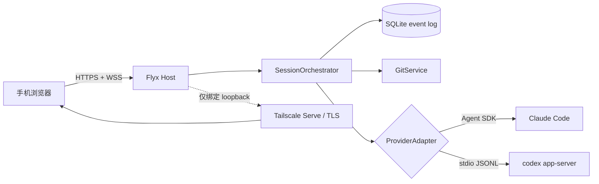

# Flyx 双 Provider 远程控制技术方案

状态：已实现首个可运行纵向切片  
适用版本：Flyx MVP Protocol v2  
Provider：Claude Code、Codex CLI

## 1. 结论

Flyx 采用“本机 Provider 进程 + Flyx Host 控制面 + 同源移动 Web”的三层架构：

- Claude Code 通过 `@anthropic-ai/claude-agent-sdk` 驱动；
- Codex CLI 通过 `codex app-server` 的本地 stdio JSONL 协议驱动；
- 手机只连接 Flyx 的 HTTPS/WSS，不直接连接任何 CLI；
- Host 启动时通过 `FLYX_PROVIDER=claude|codex` 选择 Provider；
- 一个持久化 Session 永久绑定一个 Provider，切换 Provider 使用独立数据库；
- 两个 Provider 都投影到同一套 Timeline、审批、中断、恢复和 Git Diff 语义。

这一选择可以复用已经验证过的 Flyx 鉴权、配对、事件持久化和断线追赶能力，同时避免把 Codex 当前标记为实验性的 WebSocket listener 暴露到网络。

## 2. 范围

本次实现包含：

1. Provider 中立的 Host 适配器接口；
2. Claude 现有实现迁移到公共接口；
3. Codex app-server 子进程监管和双向 JSON-RPC；
4. Codex Thread 创建、恢复和 Turn 执行；
5. 文本、命令和文件变更事件映射；
6. 命令/文件变更审批回传；
7. 中断、超时和 app-server 异常退出处理；
8. Provider 持久化、启动校验和 Provider 感知 Web UI；
9. 单元测试、可选真实 Codex 冒烟测试和原有端到端回归。

本次不包含：

- 同一 Host 同时运行多个 Session；
- 在已有 Session 中热切换 Provider；
- Codex `tool/requestUserInput`、MCP elicitation 和细粒度 permission grant 的移动端表单；
- 将 Codex app-server WebSocket 直接暴露给手机；
- 通用远程 shell 或任意 CLI PTY 转发。

## 3. 架构



信任边界：

- 手机是不可信远端，只能提交经过 Zod 校验的 Flyx RPC；
- Flyx Host 是策略执行点，负责身份、幂等、审批、路径脱敏和状态持久化；
- Provider 是本机受监管子系统，不拥有 Flyx 的浏览器凭证；
- SQLite 是恢复真相源，Provider 自身 Session/Thread id 只是关联标识。

## 4. Provider 公共契约

`ProviderAdapter` 提供以下能力：

```ts
interface ProviderAdapter {
  readonly provider: "claude" | "codex";
  readonly workspace: string;
  status(): Promise<AdapterStatus>;
  preflight(): Promise<AdapterStatus>;
  runTurn(turnId: string, prompt: string, resumeSessionId?: string): Promise<TurnOutcome>;
  interrupt(reason?: string): Promise<"accepted" | "already_terminal" | "unavailable">;
  respondApproval(approvalId: string, action: "allow_once" | "deny"): boolean;
  close?(): void;
}
```

适配器只能向 Orchestrator 发出 Provider 中立事件：

- `session_init`
- `assistant_delta` / `assistant_message`
- `tool_started` / `tool_progress` / `tool_completed`
- `approval_requested` / `approval_resolved`
- `diagnostic`
- `turn_completed` / `turn_failed` / `turn_cancelled`

每个运行中 Turn 都分配一个单调递增 `generation`。适配器把 `generation` 和 Flyx `turnId` 附加到事件，Orchestrator 拒绝迟到、跨 Turn 或已终态的事件。

## 5. Codex 接入

### 5.1 传输选择

Host 监管下面的本地子进程（实际启动参数还会附加安全配置覆盖）：

```text
codex app-server --listen stdio://
```

默认 stdio 传输是一行一个对象的 JSONL。消息使用 JSON-RPC 2.0 的请求/响应模型，但线上省略 `jsonrpc` 字段。Flyx 实现完整的双向 peer，因为审批由 app-server 主动向客户端发请求。

不选择以下方案：

- `codex exec --json`：适合一次性非交互执行，不适合审批和长生命周期恢复；
- 解析 Codex TUI/PTY：输出协议不稳定且审批语义不可靠；
- 直接远程 `codex app-server --listen ws://...`：官方仍将 WebSocket transport 标记为实验性，且 Flyx 已经有成熟的远程安全边界。

### 5.2 初始化

每个 app-server 进程只初始化一次：

```json
{"method":"initialize","id":1,"params":{"clientInfo":{"name":"flyx","title":"Flyx Mobile Host","version":"0.0.1"},"capabilities":{"experimentalApi":false}}}
{"method":"initialized","params":{}}
```

当前实现只使用稳定 API。启动 preflight 依次验证：

1. `codex --version` 可执行；
2. app-server 可以启动并完成握手；
3. `config/read` 可以读取工作区的有效配置并生成最小权限策略；
4. `account/read` 表明本机认证可用。

`config/read` 的返回值只在 Host 内存中处理，不进入 Timeline 或日志。Flyx 会枚举全部有效 `mcp_servers` 和 `plugins`，在 `thread/start`/`thread/resume` 的逐线程 `config` 中逐项写入 `enabled: false`。读取失败、结构异常、配置项数量超限都会拒绝启动 Thread。

### 5.3 Thread 和 Turn

首次 Turn：

```text
thread/start -> 保存 thread.id -> turn/start
```

Host 重启或后续恢复：

```text
thread/resume(threadId = providerSessionId) -> turn/start
```

Flyx 的 `providerSessionId` 对 Codex 等于 `thread.id`，对 Claude 等于 SDK `session_id`。

`turn/start` 固定携带：

- `cwd` 为已 canonicalize 的 workspace；
- `approvalPolicy: "on-request"`；
- `sandboxPolicy: { type: "readOnly", networkAccess: false }`；
- 可选 `FLYX_CODEX_MODEL`；
- 可选 `FLYX_CODEX_EFFORT`。

默认 read-only 是有意的：Codex 可以分析上下文，但文件编辑和命令执行不能绕过审批；网络默认关闭。配合 `approvalPolicy: "on-request"`，需要越过沙箱边界的动作必须回到 Flyx 审批闭环。

app-server 进程和 Thread 同时施加最小工具策略：

- 禁用 Apps、插件、MCP、Browser/Computer Use、Web Search、图片工具和多智能体；
- 禁用 hooks、notify、自动目标续跑、远程插件和嵌套 Remote Control；
- 禁止 login shell，子进程环境只允许 PATH、HOME、locale、临时目录等基础变量，自动排除 token/secret/key；
- 保留的 Provider 工具只有 `commandExecution` 和 `fileChange`；
- 如果未来版本仍启动 MCP，或发出 MCP/Web/Browser/动态工具/子智能体 Item，Host 立即关闭 app-server 并将活动 Turn 标为 `outcome_unknown`。

这是 fail-closed 策略：本机 Codex 的个人插件和 MCP 配置不会自动扩展到 Flyx 手机会话。

### 5.4 事件映射

| Codex app-server | Flyx 事件 | Timeline 表现 |
|---|---|---|
| `item/agentMessage/delta` | `assistant_delta` | 流式 Assistant 文本 |
| completed `agentMessage` | `assistant_message` | 权威最终文本 |
| `commandExecution` | `tool_*` / Bash | 命令、进度、输出、退出状态 |
| `fileChange` | `tool_*` / ApplyPatch | 文件变更摘要 |
| completed `plan` | `assistant_message` | 计划文本 |
| `error` | `diagnostic` | 非重试错误同时进入失败原因 |
| `turn/completed` | Turn 终态 | completed/interrupted/failed |

最终 `item/completed` 是权威状态；delta 只用于降低移动端感知延迟。

MCP、dynamic/collab、Web Search、image、hook 和 sub-agent Item 不做普通 Timeline 映射，而被视为安全策略违规并触发熔断。

### 5.5 审批

Codex 的两类稳定审批请求：

- `item/commandExecution/requestApproval`
- `item/fileChange/requestApproval`

处理顺序：

1. app-server 向 Flyx 发带 JSON-RPC `id` 的反向请求；
2. CodexAdapter 生成最长 128 字节的 Flyx `approvalId`，保存 `approvalId -> rpcId` 映射；
3. Orchestrator 在同一事务中写入 Approval、Session 状态和 Timeline；
4. 手机选择“允许一次”或“拒绝”；
5. Flyx 回复 `{decision:"accept"}` 或 `{decision:"decline"}`；
6. `serverRequest/resolved` 和最终 `item/completed` 收敛 UI 状态。

当前移动协议无法安全表达的问题/表单或任意 permission 子集，所以其它反向请求返回明确的 JSON-RPC 不支持错误并生成诊断事件，绝不静默授权。

### 5.6 中断和进程故障

中断使用：

```text
turn/interrupt { threadId, turnId }
```

请求成功不代表 Turn 已终止。只有后续 `turn/completed(status="interrupted")` 才记为 `cancelled`。五秒内没有终态则记为 `outcome_unknown`，防止 UI 错误地允许新的并发 Turn。

如果 app-server 在终态前退出：

- 所有待响应 RPC 失败；
- 所有本地待审批被标为 aborted；
- 当前 Turn 进入 `outcome_unknown`；
- 下次没有活动 Turn 时可重新拉起 app-server；
- 不把未知结果伪装成 failed 或 cancelled。

## 6. Claude 接入

ClaudeAdapter 继续使用 Agent SDK，保留：

- SDK 原生流式消息；
- `canUseTool` 审批桥；
- workspace sandbox 与路径校验；
- Session resume；
- query interrupt；
- generation fencing。

本次同时修正了运行时版本归因：未设置 `FLYX_CLAUDE_EXECUTABLE` 时，Flyx 实际使用 SDK bundled Claude Code，因此状态页显示 SDK `package.json` 的 `claudeCodeVersion`；只有显式 executable override 才执行该文件的 `--version`。这避免“检测系统 Claude、实际运行 bundled Claude”的错配。

## 7. 持久化和协议

Protocol v2 将 `provider` 从常量扩展为：

```ts
type ProviderId = "claude" | "codex";
```

`sessions.provider` 已经是 SQLite TEXT，不需要破坏性迁移。创建 Session 时写入实际 Provider；恢复时要求以下三者一致：

- 配置 workspace；
- 持久化 workspace；
- 配置 Provider 与持久化 Provider。

不一致时 Host 以 `WORKSPACE_MISMATCH` 或 `PROVIDER_MISMATCH` 失败启动。默认数据库按 Provider 隔离：

- Claude：`.flyx/mvp.sqlite`
- Codex：`.flyx/mvp-codex.sqlite`

这样可以在同一工作区轮流启动两种 Provider，而不会把 Claude Session id 误交给 Codex 或反向误用。

## 8. 远程安全

生产链路保持：

```text
Phone -- HTTPS/WSS --> Tailscale Serve -- loopback HTTP/WS --> Flyx Host
```

安全不变量：

- Host 拒绝非 loopback bind；
- 浏览器 WebSocket 必须提供精确同源 `Origin`；
- 配对 token 单次使用，浏览器会话为 HttpOnly/SameSite cookie；
- WebSocket 使用短时单次 ticket；
- 所有写 RPC 要求 `commandId` 并持久化幂等 receipt；
- Provider 子进程只继承白名单环境变量；
- Codex Thread 启动前动态禁用所有本机 MCP/插件，并关闭 Apps、浏览器、Web 与多智能体能力；
- Codex shell 禁止 login 语义，命令环境使用基础变量 allowlist；
- 公共状态只显示 executable basename 和 workspace basename；
- Provider 事件中的路径会相对化，workspace 外路径显示为占位符；
- Codex 网络默认关闭，未知交互请求 fail closed。

`app-server` 的 stdin/stdout 不跨主机，不携带 Flyx cookie，也不成为新的公网入口。

## 9. 配置与运行

Claude：

```bash
FLYX_PROVIDER=claude pnpm start:host
```

Codex：

```bash
FLYX_PROVIDER=codex pnpm start:host
```

常用覆盖：

| 环境变量 | 含义 |
|---|---|
| `FLYX_PROVIDER` | `claude` 或 `codex` |
| `FLYX_WORKSPACE` | 受控 Git 工作区 |
| `FLYX_DB` | 显式 Session 数据库 |
| `FLYX_CLAUDE_EXECUTABLE` | 覆盖 SDK bundled Claude Code |
| `FLYX_CODEX_EXECUTABLE` | Codex CLI 路径 |
| `FLYX_CODEX_MODEL` | 可选 Codex model override |
| `FLYX_CODEX_EFFORT` | `none|minimal|low|medium|high|xhigh|max|ultra` |

如果复用显式 `FLYX_DB` 切换 Provider，Host 会拒绝启动；应指定另一数据库或实现 Session archive 后再切换。

## 10. 验证策略

自动化分四层：

1. Protocol：两个 Provider schema、Frame 正反例；
2. Adapter 单元测试：Codex streaming、最小工具策略、MCP 熔断、审批、resume、interrupt、进程崩溃；
3. Host/Web 回归：原有配对、幂等、断线恢复、审批、Diff 和 crash 场景；
4. 真实冒烟：`RUN_REAL_CODEX_SPIKE=1 pnpm test:codex-spike`，验证真实 app-server 创建和恢复 Thread；可加 `RUN_REAL_CODEX_FLOW=1` 验证真实命令审批与临时工作区写入。

发布门槛：

- `pnpm run typecheck`
- `pnpm test`
- `pnpm run build`
- `pnpm test:e2e`
- 目标机器上分别完成真实 Claude 和 Codex 冒烟
- 使用真实 Tailscale HTTPS 地址完成一次手机审批与中断

## 11. 后续演进

### 阶段 A：多 Session / 同 Host 双 Provider

把 `SessionOrchestrator.session` 从单值改为 `SessionRegistry`，路由键改为 `sessionId`。每个 Session 固定一个 adapter lease；Claude 与 Codex 可以并存，但仍禁止单 Session 热切换 Provider。

### 阶段 B：完整交互模型

协议新增 discriminated union：

- yes/no approval；
- 多问题表单；
- MCP elicitation；
- permission subset 与 session/turn scope；
- network host/port 专用审批卡。

### 阶段 C：运行时治理

- app-server schema 版本快照与兼容矩阵；
- Provider capability discovery；
- 进程心跳、指标和结构化审计；
- `outcome_unknown` 人工/自动 reconciliation；
- Session archive、delete 和 provider-aware migration。

## 12. 官方协议依据

- [Codex App Server](https://developers.openai.com/codex/app-server)
- [Codex CLI](https://developers.openai.com/codex/cli)

app-server 文档明确给出 stdio JSONL、初始化握手、Thread/Turn 生命周期、事件、审批反向请求及远程连接安全要求；实现以当前安装的 Codex CLI 生成的 JSON Schema 为精确字段依据。
