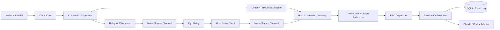
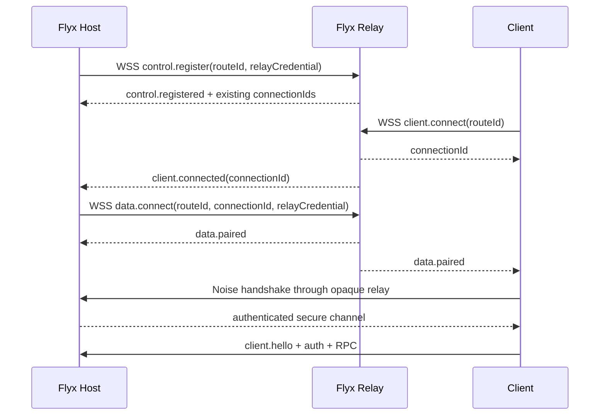

# Flyx 网络连接与 E2EE Relay 优化技术方案

- 状态：Proposed
- 日期：2026-09-07
- 适用范围：Flyx MVP Host、移动 Web/PWA、未来原生客户端、Flyx Relay
参考实现：`~/play/paseo` 的 transport、relay、E2EE 与 connection supervisor 设计

## 1. 结论

Flyx 的远程连接分两阶段交付，业务协议保持一套：

1. **近期默认使用 Tailscale Serve**：Host 始终只监听 `127.0.0.1`，由 Tailscale 提供 tailnet 内 HTTPS/WSS、NAT 穿透以及直连失败后的 DERP/Peer Relay 回退。
2. **产品化使用 Flyx E2EE Relay**：Host 和客户端都主动建立出站 WSS，Relay 只完成会合与密文转发，不终止应用层加密、不保存业务明文。
3. **Direct、Tailscale、Relay 都是同一 Host 的连接路径**：切换路径不得创建新 Host、Session 或 Turn，也不得取消正在运行的 Provider。
4. **不在首版自研 WebRTC/ICE/STUN/TURN**：Flyx 当前以请求、事件、审批和 Diff 为主，带宽较低；稳定的 WSS Relay 比 P2P 打洞更符合收益与复杂度比例。
5. **不开放 `0.0.0.0` 作为默认穿透方式**：端口映射、Tailscale Funnel、裸 FRP/ngrok 仅能作为受控诊断手段，不能成为产品默认安全边界。

目标链路：

```text
阶段 A（内测）

Mobile Browser
    │ HTTPS/WSS over tailnet
    ▼
Tailscale Serve / TLS
    │ HTTP/WS on loopback
    ▼
Flyx Host 127.0.0.1:4173 ── Provider / SQLite / Workspace


阶段 B（产品化）

Hosted Flyx App                         Flyx Host
    │                                      │
    │ WSS + E2EE                           │ outbound WSS control/data
    ▼                                      ▼
              Flyx Relay
       route metadata + opaque ciphertext
    │                                      │
    └──────── Noise secure channel ────────┘
```

## 2. 当前实现基线

### 2.1 已具备能力

- Host 强制 loopback bind，符合最小暴露原则：`apps/mvp-host/src/server.ts`。
- 配对 grant 为高熵随机值，服务端只保存 hash，默认 5 分钟失效并单次消费。
- 浏览器 credential 单次兑换 HttpOnly、Secure、SameSite=Strict 会话。
- WebSocket 使用 60 秒单次 ticket，并校验精确同源 `Origin`。
- 所有写 RPC 要求 `commandId`，Host 已有持久化幂等 receipt。
- Timeline 使用单调 sequence，客户端支持 HTTP catch-up、live subscribe、去重和缺口检测。
- 客户端已有指数退避重连，网络断开不会主动取消 Provider Turn。

### 2.2 需要修正的问题

| 问题 | 当前表现 | 影响 |
|---|---|---|
| Runbook 与实现冲突 | 文档要求 `FLYX_BIND=<ts-ip>`/`0.0.0.0`，代码禁止非 loopback | 操作者可能绕开既有安全边界 |
| Tailscale 检查过浅 | 只判断 `tailscale serve status` 有输出 | 不能证明 HTTPS、FQDN、目标端口和当前 Host 匹配 |
| 配对入口不可远程使用 | 终端打印 `http://127.0.0.1/...` | 手机无法直接扫描/打开 |
| Grant 位于 query | `/?pair=<token>` | 可能进入代理日志、浏览历史和截图 |
| 代理信任过宽 | Fastify `trustProxy: true` | 转发来源、Origin 和限流 IP 可被错误解释 |
| 客户端与同源 HTTP 耦合 | 建立 WS 前依赖 bootstrap、pairing、snapshot、timeline、ticket 等 HTTP API | 仅增加 Relay WebSocket 不能工作 |
| 缺少稳定 Host 身份 | 默认 `instanceId = local`，无持久化公钥 | 无法安全判断两个 endpoint 是否属于同一 Host |
| 缺少设备模型 | 只有 browser session，没有 device、scope、单设备撤销与活动 lease | 丢失设备或 logout 后不能立即断开既有连接 |
| 缺少应用心跳 | 依赖浏览器/代理感知 TCP 断开 | 半开连接和长时间空闲恢复慢 |
| 客户端写入无 durable outbox | 每次 UI 调用即时生成 `commandId` | 响应丢失后人工重试可能生成新命令 |

### 2.3 必须保持的不变量

1. Provider 只在 Host 本机执行，客户端与 Relay 不持有 Provider 凭证。
2. 客户端断开不等于取消 Turn；Host 继续执行并持久化事件。
3. Relay 故障只能影响实时可达性，不能改变 Session/Turn 权威状态。
4. 自动重连不得自动重放结果未知的写操作。
5. Endpoint 是候选路径，不是 Host 身份；路径切换必须验证 Host key。
6. Relay 不能读取或修改代码、Prompt、工具参数、输出、Diff 和审批内容而不被发现。
7. 设备撤销后不能创建新 lease，已有 lease 必须立即关闭。
8. 不允许从 HTTPS/WSS 静默降级到 HTTP/WS。
9. 日志不得包含 pairing grant、cookie、ticket、device secret、Relay credential 或业务正文。

## 3. 目标与非目标

### 3.1 功能目标

- 手机和开发电脑位于不同 NAT、蜂窝网络或企业网络时，无需配置公网入站端口即可连接。
- 同一个 Host 可保存 Tailscale/Direct 与 Relay 多个连接路径。
- 当前路径失败后自动回退，恢复后完整补齐 Timeline，不重复投影或执行写命令。
- 支持多个客户端同时连接，各自拥有独立加密、认证、背压和撤销状态。
- PWA 与未来原生客户端复用相同 client core、RPC、同步和连接状态机。
- 支持单设备撤销、全部设备撤销、Host key 轮换和重新配对。

### 3.2 非功能目标

- Relay 不保存业务 payload，断开后不具备离线重放能力。
- 网络切换恢复目标：网络重新可用后 P95 在 10 秒内回到 `online + synced`。
- Timeline sequence 缺口和重复写操作的可接受数量均为 0。
- 每个物理连接有固定帧上限、发送高水位、速率限制和 idle policy。
- Relay 协议与部署运行时解耦，可在 Cloudflare Durable Objects 或独立服务实现。

### 3.3 非目标

- 首版不提供通用 TCP、SSH、PTY 或文件系统隧道。
- 首版不做 UDP hole punching、ICE candidate gathering 或 TURN 服务。
- Relay 不承担 Agent 调度、Session 持久化、业务授权或 Provider 代理。
- Relay 不作为备份系统，不保存 Timeline、Diff 或附件。
- 不把 Cloudflare Access、Tailscale 身份 header 或 Relay 可达性当作 Flyx 设备授权的替代品。

## 4. 分层架构



边界规则：

- `ConnectionSupervisor` 只决定连接、重连、路径切换和 transport generation，不修改业务状态。
- Direct 与 Relay 最终都向 `ConnectionGateway` 提供同一 `DuplexTransport` 接口。
- E2EE 在 Relay transport 内完成，RPC dispatcher 永远只接收已解密、已认证的 application frame。
- `SessionOrchestrator` 不感知连接是 Tailscale、LAN 还是 Relay。
- Relay 只理解 route/control envelope，不理解 Flyx RPC schema。

建议接口：

```ts
interface DuplexTransport {
  readonly id: string;
  readonly kind: "direct" | "relay";
  readonly generation: number;
  send(frame: string | Uint8Array): Promise<void>;
  close(code?: number, reason?: string): void;
  onMessage(handler: (frame: string | Uint8Array) => void): () => void;
  onClose(handler: (info: TransportClose) => void): () => void;
}

interface AuthenticatedConnection {
  transport: DuplexTransport;
  hostId: string;
  deviceId: string;
  scopes: string[];
  leaseId: string;
  protocolVersion: number;
}
```

## 5. Host 身份、Endpoint 与连接档案

### 5.1 HostIdentity

Host 首次启动生成稳定身份，canonical 副本独立于业务 SQLite：

```ts
interface HostIdentityFileV1 {
  v: 1;
  hostId: string;                // UUIDv7 或 128-bit+ 随机 ID
  x25519PublicKey: string;
  x25519SecretKey: string;
  fingerprint: string;           // sha256(public key)，展示短格式
  createdAt: string;
}
```

要求：

- 文件创建时即为 owner-only，使用临时文件、`fsync` 和 atomic rename。
- 私钥不写日志、不进入 SQLite 备份、不进入 QR。
- SQLite 保存 `hostId + fingerprint` 镜像；二者不一致时进入 `identity_mismatch`，禁止写命令。
- 身份文件丢失视为新 Host，必须重新配对，不能静默生成同名身份。
- Host key 轮换必须由已授权设备确认或在本机终端执行，并令旧设备重新确认。

### 5.2 HostDescriptor

每个可达 endpoint 返回签名 descriptor：

```ts
interface HostDescriptorV1 {
  v: 1;
  hostId: string;
  hostPublicKey: string;
  protocol: { min: number; max: number };
  endpoints: AdvertisedEndpoint[];
  issuedAt: string;
  expiresAt: string;
  nonce: string;
  signature: string;
}
```

签名输入必须使用 canonical encoding，并覆盖全部字段。客户端只接受：

- QR 首次固定的公钥；或
- 已配对 Host 的相同 fingerprint；或
- 明确的人工重新配对流程。

### 5.3 HostProfile 与 Endpoint

```ts
interface HostProfile {
  hostId: string;
  label: string;
  hostPublicKey: string;
  fingerprint: string;
  endpoints: ConnectionEndpoint[];
  preferredEndpointId?: string;
}

type ConnectionEndpoint =
  | {
      id: string;
      kind: "direct-https";
      source: "tailscale" | "lan" | "manual";
      baseUrl: string;
      availability: "unknown" | "available" | "unavailable";
      lastRttMs?: number;
    }
  | {
      id: string;
      kind: "relay-wss";
      relayUrl: string;
      routeId: string;
      availability: "unknown" | "available" | "unavailable";
      lastRttMs?: number;
    };
```

Endpoint 变化不改变 `hostId`。自动发现到的新地址必须通过签名 descriptor 或已固定 key 的握手后才能加入 HostProfile。

## 6. 阶段 A：Tailscale Serve 方案

### 6.1 部署形态

Host 继续只监听：

```text
http://127.0.0.1:4173
```

Tailscale Serve 负责：

```text
https://<device>.<tailnet>.ts.net
  -> http://127.0.0.1:4173
```

推荐运维命令：

```bash
tailscale serve --bg --https=443 http://127.0.0.1:4173
tailscale serve status --json

FLYX_REQUIRE_TAILSCALE_SERVE=1 pnpm start:host
```

禁止在 runbook 中建议 `FLYX_BIND=0.0.0.0`。测试 HTTP 只能显式使用 `FLYX_ALLOW_INSECURE_HTTP=1`，且限定 loopback。

### 6.2 新增配置

```text
FLYX_CONNECTIVITY_MODE=local|tailscale|relay|auto
FLYX_PUBLIC_BASE_URL=https://<device>.<tailnet>.ts.net
FLYX_REQUIRE_TAILSCALE_SERVE=1
```

规则：

- `FLYX_PUBLIC_BASE_URL` 必须是无 userinfo、无 query、无 fragment 的 HTTPS origin。
- 若未显式设置，可从 `tailscale serve status --json` 只读发现；发现不唯一时拒绝猜测。
- 启动检查必须验证 HTTPS listener、目标 `127.0.0.1:<PORT>`、MagicDNS FQDN 和 Serve/Funnel 模式。
- 发现目标是 Funnel、非 loopback、错误端口或 plaintext public endpoint 时 fail closed。

### 6.3 Proxy 与 Origin

- Fastify `trustProxy` 只信任 `127.0.0.1`/`::1` 的已知本机 proxy hop。
- Public origin 优先来自 `FLYX_PUBLIC_BASE_URL`，不直接相信任意 `X-Forwarded-Host`。
- WebSocket `Origin` 必须等于 local development origin 或配置的 public origin。
- `request.ip` 只在可信 proxy hop 后解析转发头；pairing 限流同时按来源 IP、grant hash 和全局 bucket 执行。

### 6.4 配对入口

终端与桌面只生成本地 QR，不调用第三方 QR API：

```text
https://<public-origin>/#pair=<base64url(payload)>
```

```ts
interface DirectPairingPayloadV1 {
  v: 1;
  hostId: string;
  hostPublicKey: string;
  endpoint: string;
  grant: string;
  expiresAt: string;
}
```

URL fragment 不会发送给静态页面服务器。页面启动后从 fragment 读取并立即 `history.replaceState` 清理地址栏，再通过 HTTPS POST 发送 grant。

### 6.5 连接韧性

- WebSocket open timeout：10 秒。
- 应用层 `ping/pong`：在线后每 15 秒；连续两次 15 秒超时则替换 transport。
- 重连：full-jitter exponential backoff，基数 500 ms，上限 30 秒；收到浏览器 `online` 事件时允许一次立即 probe。
- 页面进入后台只降低 UI 刷新频率，不主动关闭 Provider Turn。
- reconnect 成功后先取 snapshot/watermark，再进行 `(lastSequence, watermark]` catch-up，最后接 live buffer。
- logout/revoke 必须根据 `leaseId/deviceId` 关闭所有活动 socket，而不只撤销 cookie。

## 7. 阶段 B：Flyx E2EE Relay

### 7.1 为什么选择会合 Relay

Host 与手机通常都允许 TCP/443 出站，即使双方位于 CGNAT 或严格防火墙后，也能分别连接公网 WSS。Relay 由此解决可达性，无需路由器端口转发。

Flyx 控制流以文本、结构化事件和有限 Diff 为主。相比 ICE/STUN/TURN，会合 Relay：

- 网络成功率更可预测；
- 浏览器、React Native 与 Node 共用 WebSocket 实现；
- 能复用现有 request/response/event 语义；
- 易于做限流、诊断、多客户端隔离和故障注入；
- 即使未来增加 P2P，Relay 仍然是必需的 signaling/fallback。

### 7.2 Relay 控制面与数据面

每个 Host 使用：

- 一条长期 `control socket`；
- 每个客户端一条独立 `data socket`。



Control message 最小集合：

```ts
type RelayControlMessage =
  | { type: "registered"; connectionIds: string[] }
  | { type: "connected"; connectionId: string }
  | { type: "disconnected"; connectionId: string }
  | { type: "ping"; nonce: string }
  | { type: "pong"; nonce: string };
```

Relay 不允许在 control message 中携带 Flyx application frame。

### 7.3 Relay 路由注册

首次启用 Relay：

1. Host 通过 TLS 调用 `POST /v1/routes`。
2. Relay 生成 192-bit 以上 `routeId` 和 256-bit `relayCredential`。
3. Relay 只保存 credential 的 verifier/hash；原值只返回一次。
4. Host 将 credential 保存到 owner-only 私有文件或系统 secret store。
5. Host 的 control/data socket 通过 `Authorization: Bearer` 发送 credential。

`routeId` 只是不可枚举的路由定位符，不是设备身份或应用授权。浏览器只需要 routeId 即可尝试建立 data socket，但必须在 E2EE 内通过 Flyx pairing/device auth 才能执行任何 RPC。

托管 Relay 可在路由创建时增加账号、许可证或匿名配额；这只用于防滥用和计费，不能成为 Host 端业务授权的唯一依据。

### 7.4 Relay PairingOffer

托管 App 地址：

```text
https://app.flyx.example/#offer=<base64url(canonical-json)>
```

```ts
interface RelayPairingOfferV1 {
  v: 1;
  hostId: string;
  hostPublicKey: string;
  fingerprint: string;
  relay: {
    url: string;
    routeId: string;
  };
  pairing: {
    grant: string;
    expiresAt: string;
  };
  protocol: {
    min: number;
    max: number;
  };
}
```

安全规则：

- Offer 只放在 fragment；静态 App、CDN 与 Relay HTTP access log 不应收到完整 offer。
- Grant 为 256-bit 随机值，只存 hash、5 分钟过期、单次消费。
- Relay URL 必须为 `wss:`，禁止 offer 指示 `ws:` 或任意脚本 URL。
- 客户端必须展示 Host fingerprint 的短校验码；Host key 与已存档案不一致时停止连接。
- Pairing grant 只在 E2EE channel 内发送，Relay 永远看不到。

### 7.5 E2EE 握手

禁止自行设计裸 ECDH + AEAD 拼接协议。使用经过审查的 Noise 实现，并固定 suite 与测试向量。

建议：

- 首次配对：`Noise_NK_25519_ChaChaPoly_BLAKE2s`。客户端已通过 QR 固定 Host static key，Host 暂时不知道客户端身份。
- 后续连接：设备注册 static key 后使用 `Noise_IK_25519_ChaChaPoly_BLAKE2s`，实现双向认证与前向保密。
- Noise prologue 绑定：`flyx-relay-v1 | hostId | routeId | connectionId | protocolRange`。
- 握手完成前禁止解析 Flyx application frame。
- 传输使用 binary ciphertext，不做 base64；关闭 WebSocket `perMessageDeflate`。
- 每个方向使用独立 key 与单调 nonce/counter；重复、乱序或认证失败立即关闭连接。
- 达到固定消息数、字节数或时长后 rekey；断线重连始终产生新 ephemeral key。

首次安全通道内的配对流程：

```text
Noise NK complete
  -> client.pair { grant, proposedDevicePublicKey, deviceInfo }
  -> Host verifies unconsumed grant
  -> local terminal/desktop confirmation
  -> atomically consume grant
  -> create Device record + scopes
  -> return deviceId + credential metadata
  -> reconnect with Noise IK
```

不能仅因客户端能与 Host 公钥完成加密就把它视为已授权设备。Host 公钥负责认证 Host 和保密，grant/device credential 才负责认证客户端。

### 7.6 设备凭证存储

- Android/iOS：静态私钥进入 Keystore/Keychain，优先硬件支持且不可导出。
- Desktop：owner-only secret file 或系统 keychain。
- PWA：优先使用 non-extractable WebCrypto key 并持久化到 IndexedDB；不支持时退回短期、可轮换 refresh credential，并在 UI 明确降低的安全等级。
- Hosted App 使用严格 CSP、Trusted Types、固定资源版本和零第三方脚本；PWA 的 XSS 等价于活动设备被接管。

### 7.7 Relay 可见信息

即使使用 E2EE，Relay 仍能看到：

- 源 IP、连接时间和持续时长；
- routeId、connectionId、Host 在线状态；
- 帧方向、大小和时序；
- TLS/SNI 等网络元数据。

文档不得把 Relay 描述为“无任何数据可见”。准确表述应为“业务内容零知识，连接元数据可见”。必要时可增加固定大小分桶或 padding，但不作为首版要求。

## 8. 统一应用协议

### 8.1 为什么需要统一 RPC

当前 Web 在建立 WSS 前后混合使用多个同源 HTTP API。Hosted App 通过 Relay 时没有 Host origin 的 cookie 和普通 HTTP 路径，因此需要将业务操作统一到可由 Direct/Relay 共同承载的 RPC。

HTTP 保留以下责任：

- Direct/Tailscale 静态资源；
- `/.well-known/flyx-host` 与签名 descriptor；
- Direct browser-session 和短时 WebSocket ticket；
- 大附件/文件的短期签名 URL；
- 旧版客户端兼容窗口。

WSS RPC 增加：

```text
host.bootstrap
host.getDescriptor
host.getSnapshot
host.getStatus
session.getEvents
session.getDiff
session.subscribe
access.pair
access.refresh
access.revokeSelf
```

既有写方法保持：

```text
session.startTurn
session.interrupt
approval.respond
```

### 8.2 Hello 与版本协商

Direct 的 hello 在 TLS/WSS 内发送；Relay 的 hello 在 Noise channel 内发送。

```ts
interface ClientHelloV2 {
  type: "client.hello";
  clientId: string;
  deviceId?: string;
  hostId: string;
  protocol: { min: number; max: number };
  capabilities: string[];
  transportGeneration: number;
}

interface ServerHelloV2 {
  type: "server.hello";
  hostId: string;
  hostFingerprint: string;
  protocolVersion: number;
  capabilities: string[];
  leaseId: string;
  heartbeatIntervalMs: number;
  maxFrameBytes: number;
}
```

版本无交集时返回明确错误并关闭；不能让未知 required capability 静默降级。

### 8.3 Authorization

每个连接映射为：

```ts
interface ConnectionPrincipal {
  hostId: string;
  deviceId: string;
  sessionId: string;
  scopes: Set<string>;
  leaseId: string;
  expiresAt: string;
}
```

每个 RPC 在 dispatcher 中按 method scope 检查，不能把“完成握手”解释为无限权限。建议首版 scope：

```text
host:read
session:read
session:write
approval:write
access:self
access:admin
```

### 8.4 请求、响应与事件

继续使用显式 request/response/event envelope，但增加协议版本、trace 和 generation：

```ts
type RpcRequest = {
  type: "request";
  id: string;
  method: string;
  commandId?: string;
  transportGeneration: number;
  payload: unknown;
};
```

要求：

- `id` 只关联一次物理请求；`commandId` 标识逻辑写命令并跨重试保持稳定。
- 旧 transport generation 的响应和事件不得修改当前 client state。
- 所有入站 frame 先做大小限制，再做 schema 校验，再做授权。
- 未知 method、未知 required event 或不兼容 capability 必须显式失败。

## 9. 连接状态机与路径切换

### 9.1 Client ConnectionSupervisor

```text
idle
  -> probing
  -> connecting_transport
  -> secure_handshake
  -> authenticating
  -> synchronizing
  -> online
  -> degraded
  -> backoff
  -> connecting_transport

任何状态 -> revoked / incompatible / stopped
```

`transportStatus` 与 `domainSyncStatus` 必须分离。例如 WSS 正常但 `session.subscribe` 失败时，只重建订阅，不拆除健康 transport。

### 9.2 Endpoint 选择

排序原则：

1. 已选择且仍健康的 endpoint；
2. 已固定 Host key、连续 probe 成功的 Direct/Tailscale endpoint；
3. Relay endpoint；
4. 手工 endpoint；
5. 永不自动选择 loopback、plaintext 或 Host key 不一致的 endpoint。

防抖规则：

- 当前路径失败：两次 liveness failure 后立即选择可用备用路径。
- Relay 升级到 Direct：Direct 连续 3 次 probe 成功，且 RTT 至少改善 40 ms 或用户显式偏好 Direct。
- 活跃写 RPC 尚无 receipt 时不做仅为了性能的切换；故障切换仍允许，但重试复用原 `commandId`。
- 每次切换递增 `transportGeneration`，关闭旧 transport 前先阻止其更新状态。
- 路径切换后必须重新执行 hello/auth/snapshot/catch-up，不复用旧 lease。

### 9.3 Host RelaySupervisor

```text
stopped -> connecting -> registering -> online
              ^             │           │
              └── backoff <-┴-----------┘
online -> draining -> stopped
```

- control heartbeat 每 10 秒，30 秒未看到有效流量则替换 socket。
- reconnect 使用 full jitter，1 秒基数、30 秒上限。
- Relay 返回现存 connectionId 集合时，Host 幂等建立缺失 data socket。
- 每个 data socket 15 秒 open timeout、10 秒 secure-handshake timeout。
- 同一 connectionId 只允许一对 socket；新 generation 原子替换旧 generation。

## 10. 同步、幂等与背压

### 10.1 Timeline 恢复

沿用现有 watermark 算法：

1. 获取 snapshot 和 `headSequence = W`。
2. 在 Host 注册 live buffer。
3. 分页回放 `(clientSequence, W]`。
4. 按 sequence 发送 buffer 中 `> W` 的事件。
5. 客户端去重并要求 sequence 连续。
6. 发现 gap 时暂停 projection，调用 `session.getEvents`；不能直接跳到最新状态。

Relay 只改变帧路径，不能改变这套恢复语义。

### 10.2 Durable command outbox

客户端在发送写操作前持久化：

```ts
interface PendingCommand {
  commandId: string;
  hostId: string;
  method: string;
  payloadHash: string;
  createdAt: string;
  state: "queued" | "sent" | "receipt_unknown" | "accepted" | "terminal";
}
```

规则：

- 网络超时进入 `receipt_unknown`，不生成新 commandId。
- 重连后先查询 receipt，再决定是否重发原命令。
- Provider 已可能产生外部副作用但 Host 无法确认时继续使用 `outcome_unknown`，禁止自动重放。

### 10.3 帧与队列限制

- Control JSON 建议上限 64 KiB。
- 普通 application frame 上限沿用 256 KiB；大 Diff/附件分页或走签名下载。
- 每 data socket 发送高水位 1 MiB；超过后关闭为 `RESYNC_REQUIRED`。
- Relay 每 route、IP、device 和连接分别限速，不能只按 IP。
- Ciphertext 使用 binary frame；禁用压缩，避免压缩侧信道和不可控内存。
- 慢客户端只能影响自己的 socket，不能阻塞 Provider Turn 或其它客户端。

## 11. 数据模型

### 11.1 私有文件

```text
.flyx/identity/host-identity.json       # 0600，Host private key
.flyx/identity/relay-registration.json # 0600，routeId + Relay credential
```

生产桌面版可将 secret 部分迁入 Keychain/DPAPI/libsecret；文件只保留引用和非敏感元数据。

### 11.2 SQLite 增量表

```sql
CREATE TABLE devices (
  id TEXT PRIMARY KEY,
  host_id TEXT NOT NULL,
  display_name TEXT,
  platform TEXT NOT NULL,
  credential_kind TEXT NOT NULL,
  public_key TEXT,
  credential_hash TEXT,
  scopes_json TEXT NOT NULL,
  created_at TEXT NOT NULL,
  last_seen_at TEXT,
  revoked_at TEXT
);

CREATE TABLE protocol_sessions (
  id TEXT PRIMARY KEY,
  device_id TEXT NOT NULL,
  protocol_version INTEGER NOT NULL,
  transport_kind TEXT NOT NULL,
  transport_generation INTEGER NOT NULL,
  capability_json TEXT NOT NULL,
  connected_at TEXT NOT NULL,
  disconnected_at TEXT,
  close_code TEXT
);

CREATE TABLE access_audit_events (
  id TEXT PRIMARY KEY,
  device_id TEXT,
  action TEXT NOT NULL,
  target_type TEXT,
  target_id TEXT,
  transport_kind TEXT,
  occurred_at TEXT NOT NULL,
  result_code TEXT NOT NULL
);
```

扩展现有 pairing grant：

```text
host_id, requested_scopes, expires_at, consumed_at, approved_at, device_id
```

审计记录不包含 Prompt、Diff、Tool 输入输出、grant、token、cookie 或完整公钥。

## 12. Relay 服务实现

### 12.1 推荐首版

首版使用 TypeScript 实现 RelayPort，部署适配器优先考虑 Cloudflare Durable Objects：

- 一个 `routeId` 映射一个 Durable Object；
- control/client/data 都是该对象接受的入站 WebSocket；
- 使用 WebSocket Hibernation 降低空闲成本；
- socket attachment 只保存 role、connectionId、generation 等路由元数据；
- Durable Object storage 不保存业务 frame；
- 业务 payload 原样以 binary ciphertext 转发。

同时保留独立服务适配器接口，以便未来因区域可用性、监管、成本或连接规模切换到 Go/Elixir/Node 集群，而不改变 Host/Client 协议。

### 12.2 Relay 内部接口

```ts
interface RelayRoom {
  attachControl(socket: RelaySocket, principal: RelayHostPrincipal): Promise<void>;
  attachClient(socket: RelaySocket): Promise<string>; // connectionId
  attachData(socket: RelaySocket, principal: RelayHostPrincipal, connectionId: string): Promise<void>;
  detach(socketId: string): Promise<void>;
}
```

Relay 必须验证：

- URL path、protocol version、role、routeId 和 connectionId schema；
- control/data 的 Host Relay credential；
- 单 route 连接数、单 IP 建连速率、单帧大小和缓冲量；
- Host data socket 与待配对 client connectionId 的一致性；
- 重复 role 或旧 generation 的原子替换规则。

### 12.3 Relay 不应做的事

- 不解析 Flyx request/response/event。
- 不持久化 ciphertext 用于离线消息。
- 不把 Relay credential 下发给客户端。
- 不根据 Host 声明自动授予 Flyx scope。
- 不终止 Noise、不保存 session key。
- 不记录完整 routeId、connectionId、query 或 frame；日志使用短 hash。

## 13. 安全模型

| 威胁 | 控制 |
|---|---|
| 公网扫描/端口攻击 | Host 无公网 listener；Relay 独立限流 |
| 恶意 Relay 读取内容 | Noise E2EE，Host key 由 QR/已有档案固定 |
| 恶意 Relay 冒充 Host | 客户端验证 pinned Host static key |
| 恶意 Relay 注入/重放 | AEAD、方向 key、单调 counter、generation binding |
| 未授权客户端发送命令 | 单次 grant + 本机确认；后续设备双向认证；逐 method scope |
| QR 泄漏 | 5 分钟、单次消费、本机确认、可撤销 |
| 手机丢失 | DeviceRegistry、服务端撤销、关闭活动 lease |
| DNS rebinding/跨站 WS | Host allowlist、精确 Origin、SameSite cookie、短时 ticket |
| Host key 被替换 | fingerprint pinning、descriptor 签名、identity mismatch fail closed |
| 慢客户端/内存耗尽 | frame limit、速率限制、有界队列、per-socket backpressure |
| Hosted PWA XSS | CSP、Trusted Types、零第三方脚本、non-extractable key、短 credential |
| Relay/网络不可用 | 本地执行持续；自动重连；Direct/Tailscale fallback |

Relay 仍可丢包、断开、延迟、拒绝服务和观察元数据。E2EE 不提供 Relay 可用性保证。

## 14. 可观测性

### 14.1 Host 指标

```text
flyx_transport_connections{kind,state}
flyx_transport_connect_duration_ms{kind}
flyx_transport_reconnect_total{kind,reason}
flyx_transport_liveness_rtt_ms{kind}
flyx_transport_switch_total{from,to,reason}
flyx_relay_control_state
flyx_relay_data_connections
flyx_e2ee_handshake_total{result,reason}
flyx_device_auth_total{result,reason}
flyx_timeline_resync_total{reason}
flyx_socket_backpressure_close_total{kind}
```

### 14.2 Relay 指标

```text
relay_routes_online
relay_control_connections
relay_client_connections
relay_pairs_active
relay_pair_duration_ms
relay_bytes_forwarded{direction}
relay_connect_rejected_total{reason}
relay_backpressure_close_total
```

日志只能记录：traceId、短 hash、状态、耗时、计数、close code 和脱敏错误码。禁止记录应用 frame 和秘密。

## 15. 测试与验收

### 15.1 单元测试

- Offer canonical encoding、fragment decode、过期和非法 URL。
- Host identity 原子创建、权限、丢失与 mismatch。
- Noise 官方 test vector、错误 key、篡改、重复帧、乱序和 rekey。
- Device grant 单次消费、并发 CAS、scope、撤销。
- Connection state machine、generation fencing、endpoint 防抖。
- Relay room 的重复 control/data/client、旧 generation 和限流。

### 15.2 集成测试

- Direct 与 Relay 对同一 RPC fixture 运行完全相同的契约测试。
- Relay 只能看到 ciphertext，测试日志中不存在已知 Prompt marker。
- Host control 断开后重连并通过 `sync(connectionIds)` 恢复 data socket。
- 客户端在 HTTP snapshot、WS subscribe 和 Relay connect 各崩溃点恢复。
- logout/revoke 后既有 socket 在限定时间内关闭。
- Relay 重启、Host 重启、客户端重启均不重复 Turn。

### 15.3 故障注入

- 30 秒、5 分钟和 30 分钟断网。
- Wi-Fi/蜂窝切换、DNS 失败、TLS 握手失败、hard NAT。
- 丢包、延迟、带宽限制、半开 TCP、重复和乱序控制事件。
- Relay control 正常但 data socket 失败，反之亦然。
- 慢客户端超过高水位，确认其它客户端和 Provider 不受影响。
- Host 在命令 receipt 提交前后分别崩溃。

### 15.4 真机退出条件

1. Host 无公网入站端口，手机蜂窝网络可通过 Relay 完成配对。
2. 手机从 Wi-Fi 切换蜂窝，运行中 Turn 不取消，10 秒目标内恢复。
3. 恢复后 Timeline sequence 连续、无重复 item、无重复命令。
4. Relay 运营侧日志和存储中找不到测试 Prompt、Diff 或 Tool marker。
5. 错误 Host key、过期 grant、撤销 device、重放 ciphertext 全部 fail closed。
6. Relay 故障时 Tailscale endpoint 可回退；路径切换后仍是同一 Host/Session。
7. logout 和远程 revoke 都能关闭活动 lease。
8. 空闲 30 分钟后首次操作可用，或能在一次自动重连后恢复。

## 16. 交付顺序与兼容策略

### Gate A：修正现有 Tailscale 路径

- 更新 runbook，固定 loopback + Serve。
- 增加 public base URL、真实 Serve 校验、terminal QR 和 fragment grant。
- 收紧 proxy trust，增加 heartbeat/open timeout/jitter/revoke lease。
- 不改变现有业务 RPC。

退出：真实手机通过 Tailscale 完成配对、Turn、审批、中断、断网补同步。

### Gate B：身份与 Client Core

- 落地 HostIdentity、HostDescriptor、DeviceRegistry。
- 从 `app.tsx` 提取 ConnectionSupervisor、SyncEngine、durable command outbox。
- Direct transport 先接入新 client core，行为必须与旧 Web golden test 一致。
- 协议同时支持 v1/v2，新增 capability 默认关闭。

退出：仅 Direct/Tailscale 路径下完成身份固定、设备撤销和 v2 hello。

### Gate C：Relay Alpha

- 实现 RelayPort、control/data sockets、route registration 和 E2EE。
- Hosted App 从 fragment 导入 offer。
- 将 bootstrap/snapshot/timeline/diff 补为 transport-neutral RPC。
- 以 feature flag 启用，不影响 Tailscale 默认路径。

退出：端到端真机、故障注入、安全测试全部通过。

### Gate D：多路径与生产加固

- 保存多个 endpoint、后台 probe、Host key 校验和自动切换。
- Relay 配额、滥用防护、区域部署、SLO 与告警。
- 最低客户端版本、密钥轮换、设备管理 UI 和兼容窗口。

退出：Direct ↔ Relay 切换不改变 Host/Session，连续运行和恢复指标达标。

### 回滚

- Relay 始终由 capability/feature flag 控制，可关闭并回退 Tailscale。
- 数据库迁移只做 additive change；旧版忽略新表。
- v2 Host 至少保留一个发布窗口的 v1 Direct 支持。
- 不在同一发布中同时移除 v1、切换 Host identity、迁移设备 credential 和启用 Relay 默认值。

## 17. 建议代码边界

```text
packages/mvp-protocol/src/
├── application-frames.ts
├── handshake.ts
├── connection-offer.ts
├── host-descriptor.ts
└── relay-control.ts

packages/client-core/src/
├── connection-supervisor.ts
├── sync-engine.ts
├── command-outbox.ts
├── host-profile-store.ts
└── transports/
    ├── direct-web.ts
    └── relay-e2ee.ts

apps/mvp-host/src/
├── identity/
│   └── host-identity.ts
├── auth/
│   ├── device-registry.ts
│   └── connection-authorizer.ts
├── api/
│   ├── connection-gateway.ts
│   └── rpc-dispatcher.ts
└── relay/
    ├── relay-supervisor.ts
    └── relay-transport.ts

apps/mvp-relay/src/
├── relay-port.ts
├── route-registry.ts
├── relay-room.ts
└── cloudflare/
    └── durable-object-adapter.ts
```

迁移时先抽公共逻辑，再替换调用方；不要在 `server.ts` 或 `app.tsx` 内继续堆叠 Relay 分支。

## 18. 从 Paseo 借鉴与明确偏离

借鉴：

- daemon 主动建立 outbound relay control socket；
- 每个客户端独立 data socket；
- transport-neutral client；
- QR fragment 携带 daemon public key 与 relay endpoint；
- Relay 转发 E2EE frame；
- Direct/Relay 作为同一 Host 的连接候选；
- heartbeat、open timeout、backpressure、snapshot + delta 恢复。

偏离：

- Flyx 不把可完成 ECDH 或知道 offer 等同于客户端授权；增加一次性 grant、DeviceRegistry、scope 和双向认证。
- Flyx 首版即加入连接内 replay 防护与 counter/generation binding。
- Flyx 将 Host identity 与 Relay routeId 分离；routeId 不是 Host 身份。
- Flyx 不直接复制 Paseo 的 AGPLv3 代码；只参考架构和公开协议思想，独立实现并使用兼容依赖。
- Flyx Relay 不承载完整 Paseo daemon 协议、terminal/file tunnel 或多 Agent 功能。

参考代码：

- `../../paseo/packages/server/src/server/relay-transport.ts`
- `../../paseo/packages/relay/src/encrypted-channel.ts`
- `../../paseo/packages/client/src/daemon-client-relay-e2ee-transport.ts`
- `../../paseo/packages/app/src/runtime/host-runtime.ts`
- `../../paseo/packages/protocol/src/connection-offer.ts`
- `../../paseo/SECURITY.md`

## 19. 外部参考

- [Tailscale connection types](https://tailscale.com/docs/reference/connection-types)
- [Tailscale Serve CLI](https://tailscale.com/docs/reference/tailscale-cli/serve)
- [Cloudflare Tunnel](https://developers.cloudflare.com/cloudflare-one/networks/connectors/cloudflare-tunnel/)
- [Cloudflare Durable Objects WebSockets](https://developers.cloudflare.com/durable-objects/best-practices/websockets/)
- [Noise Protocol Framework](https://noiseprotocol.org/)
- [OWASP WebSocket Security Cheat Sheet](https://cheatsheetseries.owasp.org/cheatsheets/WebSocket_Security_Cheat_Sheet.html)

## 20. 最终决策摘要

| 决策 | 选择 | 原因 |
|---|---|---|
| 当前可用远程路径 | Tailscale Serve | 已成熟处理 NAT、TLS 和中继，改造最少 |
| Host bind | 永远 loopback 默认 | 缩小攻击面，避免误用公网暴露 |
| 产品化穿透 | Outbound WSS E2EE Relay | 无客户端 VPN 依赖，可靠穿过 NAT/防火墙 |
| Relay 数据权限 | 零业务明文 | 代码与 Agent 内容不信任 Relay 运营方 |
| 安全握手 | Noise NK 配对、IK 重连 | Host key pinning、设备认证、前向保密与 replay 防护 |
| 客户端架构 | transport-neutral Client Core | Direct/Relay 共用协议、同步、幂等和状态机 |
| 路径切换身份 | hostId + pinned public key | endpoint 变化不产生新 Host，阻止错误切换 |
| 首版 P2P | 不做 WebRTC/ICE | Relay 更可靠，控制面带宽不值得增加复杂度 |
| Relay 首版部署 | Durable Objects adapter + 独立 RelayPort | 快速交付，同时保留迁移到独立集群的能力 |
