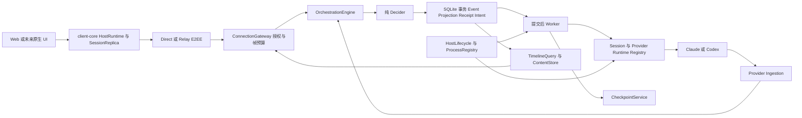
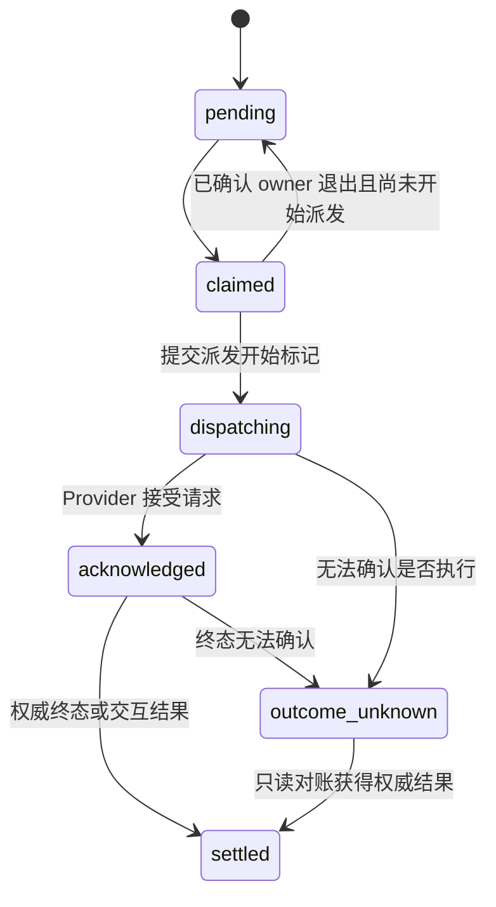

# Flyx 对照 Paseo 和 T3 Code 的能力差异与优化技术方案

> 版本：v1.1  
> 日期：2026-10-14  
> 状态：待实施的工程方案  
> 目标：把现有双 Provider 移动远控 MVP 加固为可持续使用、可恢复、可审阅的个人开发控制台

## 1 结论与实施边界

Flyx 已有 Claude/Codex 接入、SQLite 事件与回执、手机审批、中断、Tailscale、设备撤销、独立 Host 身份和 E2EE Relay。下一阶段应围绕一次真实开发任务的完整生命周期推进：开始执行、离开页面、重新连接、处理交互、审阅变更、遇到故障后核对并继续。

引入方向分为两条：

- 从 **Paseo** 借鉴运行时与持久会话分离、按需加载、Provider capability、权威 Timeline 分页、移动端副本与 attention 路由。
- 从 **T3 Code** 借鉴纯决策与事务提交、提交后执行副作用、可排空 worker、连接与领域同步分层、Git checkpoint 和版本更新的预检机制。

Host 继续使用 Node/TypeScript、Fastify、Zod 和 SQLite。上述机制按 Flyx 的接口和持久化边界实现；Host 身份、HttpOnly Direct 会话、设备授权、Noise NK/IK 通道及 Relay 控制协议沿用现有实现。展示状态、业务命令、Provider 进程和网络路径分别管理，避免一个组件同时拥有多个生命周期。

本轮交付顺序是：**可复现验证与 Host 所有权 → 原子命令与恢复 → 长会话和大内容 → 多 Session 与移动交互 → 精确 Diff → 运维与后续扩展**。原生客户端、推送、多智能体和额外 Provider 在对应前置能力验收后展开。

本方案接续[双 Provider 技术方案](./dual-provider-remote-control-technical-design.md)和[网络与 E2EE Relay 方案](./network-connectivity-and-e2ee-relay-technical-design.md)。早期[Host 生产化方案](./mvp-go-and-host-productionization-technical-design.md)中的安全与故障约束继续适用；其中 Claude-only、尚未抽取 client-core、尚未实现身份和设备管理的阶段假设，以本方案的当前基线和实施顺序为准。

源码级实施细节见[分阶段实施方案与代码改造细节](./flyx-optimization-implementation-plan.md)。其中将 W01–W12 拆为 18 个可审阅改动，明确现有函数、事务、迁移、接口、控制调度和验收；具体 DDL 与迁移按该实施方案细化。

## 2 本地对照基线与证据

### 工作树范围

| 项目 | 本地路径 | 对照快照 | 工作树状态 |
| --- | --- | --- | --- |
| Flyx | `/Users/lex/play/flyx` | `db6c6e6` 加当前未提交实现 | 双 Provider、client-core、Relay 等部分实现尚未提交 |
| Paseo | `/Users/lex/play/paseo` | `710851ccb` | 对照时工作树干净 |
| T3 Code | `/Users/lex/play/t3code` | `4ba4871af` | 对照时工作树干净 |

比较对象是这三个本地快照。源码存在、测试通过和线上运行证据分别记录，不以功能名称或设计文档中的目标代替实现状态。参考源码的位置与关键符号集中列在第 13 节。

Paseo 根许可证为 AGPLv3，T3 Code 根许可证为 MIT，具体第三方文件以各自声明为准。本方案以机制参考和独立实现为主；实际源码复用另行记录来源、文件许可和依赖，避免把分析引用与实现依赖混为一体。许可证文件见 P09、T09。

### Flyx 实测基线

以下结果来自同一评估会话中的当前工作区验证，真实 Provider 冒烟关闭。

| 检查 | 结果 | 解释 |
| --- | --- | --- |
| 类型检查 | 当前有构建产物的工作区通过 | 不代表无构建产物环境通过 |
| 全量构建 | 通过 | 包括 Host、Web、协议、客户端核心与 Relay |
| Host 测试 | 181 通过，2 跳过 | 真实 CLI 的兼容与认证闭环仍需单独验证 |
| Relay 测试 | 43 通过 | 本机服务、TLS、转发与 Cloudflare 适配器测试 |
| secure-channel 测试 | 48 通过 | 测试向量及加密通道边界 |
| Protocol 源码测试 | 29 通过 | 默认发现到 `dist` 副本时会显示 58 次通过 |
| client-core 测试 | 19 通过，2 失败 | 测试注入参数仍沿用旧顺序，把 profile 当成 generation |
| Web 单测 | 4 通过 | Timeline 和状态投影 |
| 浏览器 E2E | 22 通过，2 失败 | 使用本机 Chrome；指定 Chromium 未安装 |

默认 `pnpm test` 会在故意包含错误的 `claude-fixtures` 中提前失败；上表的业务包结果通过排除该夹具、继续执行取得。E2E 的失败分别来自过时的安全提示断言和历史消息匹配导致的竞态；崩溃场景单独重跑通过。真实手机、Claude/Codex 真实审批和中断、线上 Relay 的平台恢复与成本不属于这些确定性结果。

### 定向复现的阻塞问题

B01–B05 使用临时数据库、注入的 Adapter 和共享 Gateway/SyncEngine 的内存 Direct transport；B06–B09 为后续源码核对中的函数、内存 Outbox、注入 Codex client 和临时 Git 仓库验证，未调用真实 Provider。

| 编号 | 条件 | 观察结果 | 影响 |
| --- | --- | --- | --- |
| B01 | 在同一数据库构造第二个 Orchestrator | 第一实例的活动状态从 `running` 变成 `outcome_unknown` | 第二次启动在监听端口之前就改变现有任务 |
| B02 | 中断事件写入时注入失败 | 回执保留 `accepted`，活动状态仍为 `running` | 重试原 commandId 只拿回旧回执，没有派发中断 |
| B03 | RPC 返回 300 KiB Diff | 连接以 `1009 / FRAME_TOO_LARGE` 关闭，未收到 Diff 响应 | Git 的 2 MiB 内容上限与 RPC 的 256 KiB 帧上限不一致 |
| B04 | 4,100 条历史事件首次补同步 | `RESYNC_REQUIRED`，cursor 仍为 0 | 订阅先推历史，4,096 条客户端缓冲在分页开始前溢出 |
| B05 | 无构建产物的临时源码副本检查 secure-channel | `TS2307`，无法解析 `@flyx/mvp-protocol` | workspace 导出依赖 `dist`，Verify workflow 缺少前置构建 |
| B06 | Web 同一 Item 连续收到两个追加片段 | “Hello” 加 “ world” 被显示为 “ world” | raw delta 与累计正文语义混用 |
| B07 | Codex 首轮 thread/start 失败，随后执行第二轮 | DB generation=2、Adapter generation=1；最终 completed 但 assistant Item 未持久化 | 独立计数器失配使合法 Provider 事件被过滤 |
| B08 | Outbox 命令为 accepted 或已标 outcomeUnknown | 即使 Host 已有终态，reconcile 发出的查询仍为 0 | 新恢复路径需要允许只读再核对，并继续禁止未知副作用重发 |
| B09 | Git rename 使用 NUL 格式 status | 目标路径之外出现伪造的 “DME.md” 文件 | rename 的额外源路径被误当成新的状态记录 |

此外，`recoverActiveTurns()` 将未完成 Turn 保守标为 `outcome_unknown`，现有 E2E 明确断言会话一直锁住，尚无核对后继续工作的 API。真实兼容矩阵脚本等待旧的 `Pairing token:` 就绪行，当前非 TTY 启动不产生该行，验证入口需要一起修正。（见 F01、F03、F04、F07）

## 3 能力差异与引入判断

| 能力 | Flyx 当前实现 | Paseo 本地实现 | T3 Code 本地实现 | Flyx 决策 |
| --- | --- | --- | --- | --- |
| 会话与运行时 | 一个当前 Session；Provider 启动时选择 | AgentManager 管多个 Agent，`closed` 可按 handle 重新加载 | Project/Thread 加 Provider instance/session 路由 | 引入 SessionRegistry 和独立 runtime residency，P1 |
| Host 所有权 | Orchestrator 打开 DB 后立即恢复活动 Turn | PID lock、心跳和 managed helper process registry | scope 管理 Provider；启动有命令 readiness gate | 排他 Host owner 与进程身份核对，P0 |
| 命令一致性 | startTurn、审批、终态部分路径已有原子提交；interrupt 存在分裂窗口 | 管理器、运行状态、存储接口协调生命周期 | decider、Event、Projection、accepted receipt 同 SQL 事务 | 统一 Flyx 事务边界，增加持久执行意图，P0 |
| 异步副作用 | commandTail/eventTail 加直接 Adapter 调用 | 会话事件 drain、注册和关闭 barrier | Provider/Reactor/Checkpoint worker 可 drain | 引入有界 worker 与 producer 关闭顺序，P0 |
| 故障恢复 | 标记未知、不重放，缺少继续路径 | native handle、resume、history hydration、按需加载 | readThread、rollbackThread、持久 Thread 与 runtime 分离 | 增加只读对账和显式恢复，P0 |
| Timeline | 原始 Event 重放；UI 再投影；每次刷新从 0 开始 | tail/before/after、epoch、投影源范围、完整 catch-up | shell/thread snapshot 加 domain event、先订阅后取快照 | 采用权威页与 live delta 分工，P0 |
| 大内容 | 按事件数分页；整段 Diff RPC 返回 | 有投影数量限制和工具输出限制 | 独立 Diff query、流合并 | 加最终编码字节预算与 contentRef，P0 |
| 客户端核心 | 已有 Supervisor、RPC、outbox；Timeline state 仍在 Web | HostRuntimeController、持有副本、缓存先恢复 | client-runtime 持有连接、缓存、领域状态 | 补 SessionReplica、领域同步和平台 wakeup，P1 |
| 网络恢复 | 心跳、路径切换、抖动退避；连接成功即清退避 | 多 Host runtime 和重新连接/可见性同步 | 离线等待、前台 probe、长期后台替换、稳定窗口清退避 | 借鉴 T3 Supervisor 策略，P1 |
| Provider 能力 | 两个 Adapter；bootstrap 基本写死 capability | manifest、models/modes/features、native handle | driver/instance/adapter registry、用户输入和 thread 操作 | capability 与安全 policy 分开，P1 |
| 审批与提问 | allow_once/deny；未接通结构化 Question | tool/plan/question/mode 请求、动作与表单 | approval 和 user-input 为独立命令及 Adapter 操作 | 类型化交互、版本校验和手机卡片，P1 |
| 变更审阅 | Session HEAD 基线；未跟踪文件无内容 patch | checkout Git service、Provider rewind capability | 隐藏 Git ref、Turn/Thread diff、workspace/provider revert | 先精确 Diff，后预览与分阶段回退，P1/P2 |
| 多工作区 | 配置一个 canonical workspace | opaque workspaceId，local/worktree 归属 | environment/project/thread 和 VCS worktree | ID 路由、同 checkout 串行，隔离并发，P1/P2 |
| 移动端 | 简单 React Web；无推送/原生生命周期层 | Expo、Question UI、attention/presence 与 push | 原生 Mobile 与 Web 共享 client-runtime | 先 Web 的闭环与 wakeup，原生/推送后续引入 |
| 运维与升级 | shell 启动；增量迁移；Relay 已有指标/runbook | daemon CLI、桌面监管、进程记录 | service 生命周期、精确版本 candidate preflight、资源 sidecar | 先 doctor/backup/版本矩阵，再 self-update 和 sidecar |
| 数据底座 | SQLite 事件、投影、回执、身份镜像与设备表 | Agent 等记录主要为文件 JSON；Timeline 有内存实现及可注入 durable 接口 | SQL 事件源与投影迁移 | 保留 SQLite，按领域拆 Store 接口与版本迁移 |

### 参考实现需要改造的边界

1. **持久化与内存队列分开。** T3 的 `DrainableWorker` 使用内存事务队列和 outstanding 计数；`drain()` 能证明当前进程的工作排空，不能证明 crash 后副作用是否派发。其 `RuntimeReceiptBusLive` 在生产中为空实现，测试 PubSub 不作为 Flyx 的持久回执来源。（见 T01、T02）
2. **Paseo 的 Timeline 合约与持久化落地分开。** `AgentManager` 可注入 durable Store，但当前默认 bootstrap 构造没有传入它，实时 Timeline 使用内存 Store。Flyx 借鉴投影页、cursor 和合并规则，保留 SQLite 事实来源。（见 P01、P02）
3. **中断 ACK 与 Turn 终态分开。** Paseo 在 interrupt 成功但终态等待超时后存在本地 `turn_canceled` 补偿；Flyx 继续要求权威终态或确认旧运行时退出，才释放工作区执行权。无法证明结果时保留未知记录。（见 P01、F06）
4. **工作树与暂存区分开。** T3 的临时 index 捕获不修改用户 index，但当前 restore 最终执行 `git reset --quiet`。Flyx 若承诺恢复原始 staged/unstaged 区分，必须独立保存 index tree 和工作树 tree，不能只保存一个 commit。（见 T05）
5. **布局关闭与执行生命周期分开。** Paseo 的 root tab 关闭会触发 archive，subagent tab 才是布局操作。Flyx 保持关闭页面/视图不终止任务，归档只由显式命令产生。（见 P01、F05）
6. **兼容策略与校验边界分开。** Paseo 的长期兼容规范值得借鉴；Flyx v2 envelope 和安全握手仍维持严格结构校验。新增功能放在 capability 约束的新 RPC 和 payload 内，破坏性变化才升级协议主版本。（见 P06、F02）
7. **历史读取与终态证明分开。** 锁定 Claude SDK 的 getSessionMessages 提供会话消息，不直接提供统一的 Flyx Turn 终态。T3 Claude 的 rollbackThread 更新内存 turns 和 resume cursor，也不能自动等同于原生历史或文件已经回退。（见 F09、T03）

### 保留与后续扩展

保留现有 `(deviceId, commandId)` 回执隔离、method/requestHash 冲突检测、一次性 grant、撤销、Host key pin、短期 ticket、Provider 工具限制和 Relay feature flag。Paseo 的 Relay 加密格式与 Flyx Noise 协议不同；T3 的 Connect/SSH 是另一套接入与运营边界，均不与 Flyx 密文帧混用。（见 F02、F08）

额外 Provider、ACP、语音、通用终端、内嵌浏览器、service proxy、MCP 多 Agent 工具、自动循环与定时任务，分别在对应的权限、工作区、资源预算和恢复前置能力达标后评估。T3 的 Effect 技术栈、Rust 资源 sidecar 和完整原生 UI 不作为本轮基础依赖；先用现有 TypeScript 接口交付同等职责边界。

## 4 目标组件与数据流



### 组件责任

| 组件 | 拥有的状态 | 关键约束 |
| --- | --- | --- |
| HostLifecycle | Host owner、启动/关闭阶段、写入 readiness | 取得所有权后才迁移、恢复或打开 Provider；关闭 DB 最后进行 |
| WorkspaceRegistry | 已注册根目录、checkout 身份、workspace writer lease | RPC 只使用 ID；同一底层 checkout 默认只有一个写任务 |
| SessionRegistry | 持久 Session、活动 Turn、runtime residency | 归档、关闭、加载、查看历史分别定义 |
| ProviderRuntimeRegistry | 配置、探测、NativeHandle、进程、runtime generation | Provider 不能管理浏览器凭证或网络重试 |
| OrchestrationEngine | 命令顺序、事实提交、投影与幂等 | 所有外部副作用在事务提交后执行 |
| ExecutionWorker | 已提交意图的 claim、派发及结果对账 | `dispatching` 之后的未知意图不自动重放 |
| ProviderIngestion | 归一化原生事件与来源标识 | 晚到事件不能改变新 runtime/Turn |
| TimelineQuery | epoch、投影页、源事件覆盖范围 | 权威页覆盖 live 前缀；cursor 按消费源范围推进 |
| ContentStore | 不可变大内容及分片 | 访问绑定 Session/设备权限；返回受字节预算约束 |
| client-core | Supervisor、领域副本、cursor、outbox、缓存 | React 只订阅状态；一个 Host 只有一个重试所有者 |

三种 generation 不混用：`hostOwnerGeneration` 标识 Host 所有权代际；`runtimeGeneration` 隔离 Provider 加载与 Turn 事件；`transportGeneration` 隔离 RPC 连接。重连只替换最后一种，不创建新 Turn。

### 目录落点

```text
apps/mvp-host/src/
  lifecycle/host-lifecycle.ts host-owner.ts managed-process-registry.ts
  workspace/workspace-registry.ts workspace-lease.ts
  session/session-registry.ts recovery-service.ts
  orchestration/decider.ts engine.ts execution-worker.ts provider-ingestion.ts
  timeline/projector.ts timeline-query.ts content-store.ts
  checkpoint/checkpoint-service.ts revert-service.ts
  provider/types.ts runtime-registry.ts capability-manifest.ts
  storage/migrations/ session-store.ts execution-store.ts access-store.ts
  diagnostics/host-diagnostics.ts

packages/client-core/src/
  host-runtime.ts session-replica.ts timeline-reconciler.ts
  platform.ts cache-store.ts connection-supervisor.ts command-outbox.ts
```

先从现有类抽出职责并保持旧 RPC 回归，随后替换内部调用。协议、client-core 和 UI 同一批次使用共同的 capability 合约，不在 UI 中补一套独立的重连或 Provider 状态机。

## 5 Host 所有权与生命周期

### 排他执行边界

参考 Paseo 的排他锁创建与 owner 释放，引入 `HostOwnerLock`。锁记录包含随机 ownerId、PID、可验证进程启动身份、数据库 canonical 路径、HostId、启动时间和心跳。进程检查的 `EPERM`、平台不支持或检查失败都属于身份未确认，不当成进程不存在。

排他域同时覆盖数据库和 canonical identityDirectory，按固定顺序取得对应锁。现有 Claude/Codex 默认使用两个 DB，但可共享一个身份目录；同一 Host 身份不能由两个拥有不同会话/设备状态的服务同时广告。HostId 尚未初始化时先按身份目录取得锁，加载后补入锁元数据。

锁必须在 `new SessionOrchestrator()`、schema migration、`recoverActiveTurns()`、lease 恢复和 Provider preflight 之前取得。第二实例返回 `HOST_ALREADY_RUNNING`，只读管理命令使用独立的读/授权变更路径，不调用活动任务恢复。

管理命令读取已验证 schema，不自动迁移运行中 Host 的数据库。设备撤销使用经过授权的短事务或本机 owner 控制接口；身份轮换与迁移由 Host 生命周期协调。版本不兼容的 CLI 明确拒绝操作，不能通过打开 Store 顺便升级另一个进程正在使用的结构。

Paseo 的桌面 stale-lock 特例不移植为 Flyx 的默认超时抢占。心跳过期只能触发诊断；锁回收必须确认旧 owner 已退出，或者通过本机维护流程完成身份核对。释放时匹配 ownerId 和文件身份，避免删除后来实例的锁。

同一 checkout 还需要独立 workspace writer lease：两个 Host 数据目录可能指向同一 Git 工作树。单机 Alpha 的 lease 由 owner 专用协调目录按 canonical checkout 身份管理；不能仅靠各自 SQLite 的唯一索引互斥。不同 worktree 的 Git common dir 可能相同，必须按实际 worktree 根区分。网络共享工作树的跨机器并发暂不宣称受该单机锁保护。

### 进程监管

借鉴 Paseo managed-process registry，保存本 Host 实际启动的进程、owner/session/runtime generation、PID、启动身份与参数摘要。命令行包含某个名称不能作为跨重启杀进程的充分证明；启动身份缺失时保留诊断记录并阻止相关工作区的新写任务。

当前进程内优先使用 Adapter 持有的 SDK query/child handle。跨重启核对采用平台适配器；身份不匹配只移除错误关联，不能终止该 PID。真实 Claude SDK 的子进程退出保证与 Codex app-server 的 SIGTERM/退出等待都进入兼容矩阵。

Host 私有身份、数据库和 Relay 凭据放在 owner 专用数据目录。检查数据目录与可授权工作区是否重叠，避免 Provider 的合法工作区读取覆盖 Host 密钥；不能只依赖文件 mode，因为 Provider 与 Host 可能使用同一 OS 用户。目录/文件权限以及 Provider 实际读取边界均需验证。

### 启动与关闭顺序

启动依次完成：取得 owner/checkout lease → 验证数据目录与 schema 版本 → 必要的迁移备份 → 加载身份与设备 → 恢复意图/进程事实 → 启动 ingestion/worker → 打开 Gateway → 发布 readiness。参考 T3 的 command readiness gate，RPC 写 admission 与 HTTP 已监听分别表示。

Provider 不可用只影响对应 runtime 的能力；Host 可以保留受鉴权的只读诊断入口。选定 Provider 在通过现有 preflight 与最小工具策略检查前不能接受 Turn。

关闭按以下顺序执行：

1. 进入 `draining`，拒绝新业务写与新 Turn；保留查询和内部事件接收。
2. 封闭新 start intent 的派发入口；已接受但尚未派发的任务通过内部命令明确取消或保留为待恢复。
3. 对活动 Provider 发出可追踪的 interrupt/stop，等待终态或确认退出；期限到达后只处理经确认属于本 Host 的进程，并记录未确认结果。
4. 停止 Provider 事件生产后排空 ingestion，再排空 reactor/checkpoint 工作；内部结果继续经过 Engine 持久化。
5. 封闭其余 producer，排空 Engine，关闭订阅与网络 lease，最后关闭 DB 并释放 owner。

实现 `close(): Promise<void>` 和有界 `drain()`，取代同步关库加 `process.exit(0)`。关闭期间数据库或进程核对失败要返回非成功结果；不能用退出码 0 掩盖未完成排空。deadline 后须封闭迟到写回调，不能在 DB 已关闭时继续异步写入。

## 6 原子命令与持久执行意图

### 统一事务边界

保留现有 startTurn/审批/终态的原子性，扩展到 interrupt、session archive、question response 和可重试的设备撤销。命令处理顺序为：

```text
验证 scope 资源归属 expectedRevision 与 requestHash
  → pure decide 生成事件与执行意图
  → 同一 SQLite 事务写 Event Projection Receipt Intent
  → commit 后发布事件并唤醒 Worker
  → Provider 结果作为 internal command 回到同一提交边界
```

Decider 通过参数取得时间、ID 和当前投影，不读网络、Git 或 Provider。事务失败时 Adapter 调用次数必须为 0；内存投影只在成功提交后替换，必要时从已提交序列重建。

回执仍按设备和 commandId 隔离，并校验 method、规范化 requestHash、Session 和资源上下文。accepted 表示意图已持久化；任务完成、审批生效和中断完成分别由后续权威结果表示。权限检查发生在回执重用之前，撤销后不能靠旧 commandId 绕过 admission。

尚未派发的用户写在派发前再次检查设备撤销和资源 policy；撤销使这类意图明确终止。已经进入 dispatching 的操作不能仅因撤销而宣称未执行。正在运行的任务与客户端连接分开，由 Host policy 和显式中断处理；凭据轮换引起的 transport lease 更换不等同于撤销业务授权。

`access.pair`/`access.refresh` 保持专用认证与凭据轮换状态机，不进入会保存业务 payload 的 CommandOutbox。refresh secret 不写入 Session Event 或长期业务回执；设备撤销等普通授权变更补齐可查询的持久回执。

### ExecutionIntent 状态



`dispatching` 必须在调用 Provider 之前持久化。它表示调用可能尚未发生，也可能已发生，不能在重启后直接重试。`claimed` 仅允许尚未派发用户业务写的受监管准备；接管前确认旧 owner 已停止，并通过 CAS 验证所有权与代际。

Adapter outcome 携带权威终态或明确未派发的证据；已进入 transport 后的 timeout、连接断开和缺少终态不能泛化成普通 failed 并释放执行权。运行时加载、进程启动与 checkpoint 等准备操作分别监管，不在 claimed 阶段提交用户 prompt 或交互答案。

建议核心表如下，实际 migration 需与现有 device/session 外键及回执字段一起实现：

```sql
CREATE TABLE execution_intents (
  id TEXT PRIMARY KEY,
  session_id TEXT NOT NULL REFERENCES sessions(id),
  turn_id TEXT REFERENCES turns(id),
  auth_subject_id TEXT NOT NULL,
  command_id TEXT NOT NULL,
  ordinal INTEGER NOT NULL CHECK (ordinal >= 0),
  kind TEXT NOT NULL,
  resource_id TEXT NOT NULL,
  payload_json TEXT NOT NULL,
  request_hash TEXT NOT NULL,
  runtime_generation INTEGER NOT NULL,
  source_sequence INTEGER NOT NULL,
  state TEXT NOT NULL CHECK (state IN (
    'pending', 'claimed', 'dispatching',
    'acknowledged', 'settled', 'outcome_unknown'
  )),
  claim_owner_id TEXT,
  claim_owner_generation INTEGER,
  provider_request_key TEXT,
  created_at TEXT NOT NULL,
  updated_at TEXT NOT NULL,
  UNIQUE (auth_subject_id, command_id, ordinal)
);
CREATE INDEX execution_pending ON execution_intents(state, source_sequence);
```

运行时队列只负责唤醒，持久 intent 是恢复依据。Provider 不提供原生幂等键时，不承诺跨进程的 exactly-once；Flyx 保证同一已识别命令不被重复接受，派发不确定时停止重放并进入对账。

ordinal 支持同一命令的多个同类子操作；payload 是派发与恢复所需的受控内容，不保存 refresh secret。完整外键、actor 与 result 约束见实施方案，不能只凭 method/hash 重建待执行操作。

### Worker 合约

Worker 有 admission 状态、队列字节/数量预算、当前 item、错误状态、`stopAdmission()` 和 `drain()`。outstanding 覆盖队列与正在处理的 item；成功、失败、取消均在 finally 中收敛计数。重复 jobId 不重复计数，队列拒绝不能留下一个虚假的接受结果。

业务失败被转成 internal command；数据库不可写或持续 worker 故障将 Host 转为 degraded，并阻止新增执行。T3 的内存 drain 机制用于确定性等待；Flyx 的持久恢复仍通过 ExecutionIntent 完成，测试事件总线只做观察。

派发与长任务完成等待分开：start 注册受监管的 ProviderRun 后释放派发槽位，outcome 在独立 operation 中等待；控制通道仍可派发审批和中断。Engine 把持久代际与 attempt 上下文传给 Adapter，不依赖二者各自计数器恰好相同。

## 7 Session Runtime 与故障恢复

### 持久身份与运行时驻留

持久 Session 的 active/archived 状态、当前 Turn 状态、runtime residency 分开。关闭 runtime 可以保留 Session、Timeline、工作区和 NativeHandle；打开历史不启动写任务或自动 unarchive。参考 Paseo 的加载 Promise 去重和 close barrier，同一 Session 的加载、关闭、归档必须串行。

Provider 合约向下列方向扩展，均为待实现能力：

```ts
type NativeHandle = {
  version: 1;
  provider: "claude" | "codex";
  nativeSessionId: string;
  workspaceId: string;
  providerConfigFingerprint: string;
  runtimeVersion: string;
};

type RecoveryTarget = {
  flyxTurnId: string;
  nativeTurnId?: string;
  runtimeGeneration: number;
};

type Inspection =
  | { state: "running"; flyxTurnId: string; nativeTurnId: string }
  | {
      state: "terminal";
      flyxTurnId: string;
      nativeTurnId?: string;
      outcome: "completed" | "failed" | "cancelled";
      evidence: "provider-history" | "native-terminal";
    }
  | { state: "unknown"; reason: string };

interface ProviderSessionRuntime {
  inspect(handle: NativeHandle, target: RecoveryTarget): Promise<Inspection>;
  ensureLoaded(handle: NativeHandle, purpose: "interactive" | "history"): Promise<void>;
  close(reason: string): Promise<void>;
}
```

NativeHandle 是 Host 私有持久关联，不包含 token，不直接作为客户端资源 ID。Adapter 分别声明 historyRead、resumeIdle、inspectTurn、reattachRunning、questions、rewind 等能力。Codex stdio 和 Claude SDK 不因存在 sessionId 就自动获得运行中 reattach 能力；缺少受支持方法时返回 unknown/unsupported。

终态证据必须能关联到待恢复的原 Turn，不能把该 conversation 最新的一轮结果当作它的结果。Provider request/turn key 在取得后持久化；遗留记录缺少可验证关联时返回 unknown，不能只靠相同 prompt 文本推测。配置 fingerprint 只涵盖受控配置与安全 policy 版本，不包含认证 secret。

### 恢复流程

启动恢复先依据 owner、intent 和 process identity 判断执行是否可能发生，然后对 NativeHandle 做只读核对。接口建议为 `session.inspectRecovery`、`session.reconcile` 和 `session.acknowledgeRecovery`，通过 capability `session-recovery-v1` 开放。

| 可证明的事实 | 恢复行为 |
| --- | --- |
| pending/claimed 且旧 owner 已退出，尚未标记 dispatching | 可以保留待派发或显式取消；不能当成已执行 |
| Provider 可读到原 Turn 权威终态 | 原子提交终态、投影、回执与恢复结果 |
| 原进程仍运行，Adapter 支持验证后的 reattach | 在同一 Session/Turn 下恢复 ingestion，更新 runtime generation |
| 原进程仍运行但不能 reattach | 保持工作区封锁，提供明确停止/本机处理路径 |
| 已确认原进程退出，但 Provider 结果未知 | 保留 unknown 历史，展示当前工作区变化，允许显式结束旧活动关联或新建 Session |
| 进程身份无法核对或 workspace/handle 不匹配 | 停止执行，提供诊断，不能仅靠用户点击清空执行权 |

acknowledge 只表示用户已查看未知结果，不表示任务成功。只有确认旧执行已停止、工作区 writer lease 可释放时，才清除恢复 gate。旧 Turn 的 outcome_unknown 记录保留；snapshot 的 activeTurn 关联从历史未知记录中独立管理。

现有唯一索引将 outcome_unknown 计为活动 Turn。在恢复流程完成验收前保留这一保守约束；随后配合明确 activeTurnId/recovery gate 改造，不能单独放宽索引而允许旧进程和新 Turn 并发。

Provider 历史导入按 NativeHandle、原生 messageId 与来源键去重，只在未 primed 或显式补缺时运行。已提交 Flyx 用户消息不能因 resume 再次导入；权威核对不能改写既有 commandId 或伪造收到过的 Provider 终态。

### 多 Session 与工作区归属

新增 WorkspaceRegistry 和 SessionRegistry。Workspace 记录根目录、checkout 身份、local/worktree 类型与生命周期；Session 记录 workspaceId、providerInstanceId、NativeHandle、标题、archive 和选定模式。现有 `default` workspace 和当前 Session 原样迁移，保持 ID 和事件序列。

同 Host 双 Provider 最终使用一个 catalog DB。既有 Provider 分库逐份导入主库，保留原 Session/Turn/Event ID 与 Provider 归属；重复 ID 的内容冲突阻断导入，不能覆盖。不同 Host fingerprint 的库保留为不同 Host。设备授权以选定主库为准，副库授权不自动合并为新的有效访问；必要时重新配对，历史回执的存在不授予访问权。

新命令明确传 sessionId。旧 RPC 省略 sessionId 时仅路由到迁移后的 legacy default Session，不能随着客户端当前选择改变目标。legacy Session 已归档或不可用时返回明确错误；需要 SessionRegistry 的新 UI 在能力缺失时提示升级 Host。

同 checkout 串行执行。按 canonical 根与 Git worktree 身份识别路径别名，避免两个 workspaceId 指向同一 checkout 却获得两份执行权。多个任务可以同时保留会话和历史；并发写入须使用不同 worktree。资源归属不从任意客户端 cwd 或 Provider native ID 推断。

## 8 权威 Timeline 与有界内容

### 合约

参考 Paseo 的投影页与源范围，以及 T3 的订阅先于快照边界，增加以下合约：

```ts
type TimelineCursor = { epoch: string; sequence: number };

type ProjectedItem = {
  sessionId: string;
  itemId: string;
  kind: "user_message" | "assistant_message" | "tool_call"
    | "approval" | "question" | "error" | "system";
  status: string;
  revision: number;
  displaySequence: number;
  sourceSeqRanges?: Array<{ start: number; end: number }>;
  sourceSeqRangesRef?: { ref: string; count: number; bytes: number; sha256: string };
  content: { inline: unknown } | { ref: string; bytes: number; sha256: string };
};

type TimelinePage = {
  epoch: string;
  upToSequence: number;
  items: ProjectedItem[];
  coveredSourceRange?: { fromExclusive: number; through: number };
  pageRef?: { ref: string; itemCount: number; bytes: number; sha256: string };
  nextCursor?: TimelineCursor;
  hasOlder: boolean;
  hasNewer: boolean;
};
```

`displaySequence` 在首次显示时固定，tool completion 不移动原位置。revision 使用最后影响该 Item 的已提交源 sequence 或等价的持久单调版本，重建不能在同 epoch 内重置；sourceSeqRanges 可以不连续，不能用 item 数量或最大的单个 seqEnd 推断所有中间事件已消费。

来源范围采用内联 ranges 或受授权的 rangesRef 二选一，同样受字节预算限制。after 页必须携带连续 coveredSourceRange；单个提交的 Item 元数据超预算时用不可变 pageRef，客户端读取校验后才推进消费 cursor。

新增 capability `timeline-projection-v1`，提供 `session.openView`、`timeline.getPage`、`timeline.subscribe` 和 `content.getChunk`。保留旧 `session.getEvents` 供兼容和诊断；新 UI 使用权威页管理历史。

v2 的 live 通道继续使用既有 event envelope，并携带可识别的 Session Event；相邻文本在持久化前合并成为一个已提交源事件，不把多个源 sequence 偷换成一个未说明覆盖范围的通知。大内容的 live 投影使用受预算约束的 ref/摘要，新客户端读取权威内容；旧客户端遇到无法完整展示的内容得到明确升级/截断说明，不显示虚假的全文。

### 建立订阅与冷启动

`session.openView` 先登记 live listener，再在一次只读事务中读取 Session、待处理交互、水位 W 和最近投影页，最后返回订阅 ID 与页。commit 与发布之间的重叠按 sequence 去重。API 只回最近页，历史向上滚动按 before 获取；冷启动不重放 0 到 W 的全部事件。

已有缓存 cursor 时，先建 live listener 并取得固定水位 W，再按 after 从 cursor 补到 W。订阅仅发送新 live 事件，历史由页查询负责，消除当前 subscribe 和 getEvents 的双重历史传输。

补同步期间只暂存 W 之后的 live 事件，按数量和编码字节双重限制。溢出触发该领域的新快照/水位恢复，不自动创建 Turn；正常的领域补同步错误不替换健康 RPC 连接。

tail/before 页在一次只读事务内返回自洽的当前投影与实际水位。固定 W 的 after 页必须从事件和投影 checkpoint 重建至该页消费边界；不能把 W 之后已变化的当前 timeline_items 当成 W 时的投影。不跨多个 RPC 保持长数据库事务。

落地采用版本化 Item metadata 和不可变 content ref；长文本保存 append segment 与固定 prefix，避免每个版本复制完整正文。新事务保存 commit 边界，分页不返回半个新业务提交；遗留事件缺少边界时不猜测，补到固定 W 前保持操作禁用。

### Cursor 与投影合并

after 查询按源事件范围 `(cursor, pageEnd]` 消费，包含不产生 UI Item 的事件；返回 nextCursor=pageEnd。受影响 Item 使用截至 pageEnd 的完整投影覆盖旧内容。只有 pageEnd 到达固定 W 才结束 catch-up；页的源消费范围连续性与 Item 的 sourceSeqRanges 分别校验。

客户端依次校验 Host/Session/epoch、当前 transport generation、revision 和源范围。权威全量文本替换 live 前缀，不能再次 append；tool lifecycle 更新原 Item；optimistic 用户消息通过 `clientMessageId` 原位匹配 canonical 用户行。采用 Map 与稳定顺序索引，Timeline reducer 移入 client-core。

页携带的 source ranges 与消费水位采用共同的语义：权威投影至 pageEnd，live 事件至已提交 sequence。待处理交互始终从 Session 权威快照提供，即使其 Item 不在最近历史页内。loaded window 之外的更新推进同步状态但不无限扩展可见列表，后续 before 查询仍可取得该历史 Item。

revert、显式历史重建改变 epoch，旧 cursor 进入 reset 流程。旧 cache 晚到不能覆盖更新 live state，旧 RPC generation 响应也不能更新新副本。初次 tail 只加载最近历史；恢复已有 cursor 则必须补完其后的全部源范围，不能用 tail 跳过中间部分。

### 字节预算与 ContentStore

全链路继续维持 256 KiB application frame 上限。有限查询使用建议 192 KiB 的最终 JSON 编码预算，并取不超过协商帧上限减 envelope 开销的值。预算基于 `JSON.stringify` 后的 UTF-8 字节，覆盖转义、元数据和 binary/base64 开销，不按字符或 item 数估算。

单个 Item、最终 assistant message、工具输出或 Diff 超预算时，返回固定 revision 的不可变 contentRef。chunk 包含 byte offset、next offset、总长度和 hash，UTF-8 切块对齐字符边界；读取仍经过 Session/设备 scope 和资源归属检查。引用不暴露任意路径，也不是无需鉴权的公网 URL。

Diff 先返回文件摘要，再按文件/块获取。binary、超大文件和截断均有显式状态。正常的大对象查询不能通过关闭整条连接来表达不可显示；历史页的一个大 Item 也不能阻塞 cursor 前进。

### 写入与渲染性能

对相邻 assistant delta 做可配置的小窗口合并，初始测试候选为 50 ms；approval/question/terminal 前立即 flush。合并后的 Event 必须先提交再发布，明确 crash 前尚未提交的尾部不属于持久事实。该窗口需用交互延迟与数据库写入数据验证后确定。

工具 output 在进入持久路径和 live 路径前使用同一上限；终态和审批不因普通文本合并而延后。UI 批量更新可见 Item，使用虚拟列表和大内容按需读取。分页建立 Session/sequence 与 displaySequence/revision 索引，避免每页全表扫描。

## 9 Client Core 与移动交互

### 一个 Host Runtime 与独立领域状态

HostRuntimeRegistry 为每个 desired Host 持有一个 Supervisor、RPC generation、凭据状态和领域副本。SessionReplica、设备目录和工作区状态分别表示 `empty/cached/synchronizing/live` 与 error；transport online 不等于 Timeline 已同步。领域错误在同一健康 lease 上重订阅，只有传输/认证失败才交给 Supervisor 换连接。（见 T04）

React mount/unmount 只订阅和释放观察者，不创建或清空 runtime。用户显式移除 Host 时才清理该 Host 的 profile、credential、cache、draft 和 outbox。离线“忘记本机记录”和服务端“撤销设备”分开表达，不能把前者显示成已撤销授权。

缓存只提供 stale 展示。待审批/问题以 Host 当前快照为准，缓存卡片不能直接操作；历史副本不推断删除或 idle。当前 outbox 已持久化 prompt payload，新增 Timeline 持久缓存须明确正文保护与保留策略，不能声称浏览器已有硬件保护。原生安全存储通过平台接口接入。

### Wakeup 与退避

参考 T3 的稳定窗口和 lease probe，引入网络及应用生命周期输入：

| 输入 | 行为 |
| --- | --- |
| 离线启动 | 保留 desired Host，等待 online，不消耗重试预算 |
| online/显式 retry | 唤醒建立连接，打断当前 backoff |
| 短时前台恢复 | probe 现有 lease，健康则保留 |
| 长后台恢复/系统已挂起 socket | 替换 lease 与 RPC generation，随后补同步 |
| 认证/身份/配置失败 | blocked，等待配对、凭据或配置变化 |
| 短暂连接后再次掉线 | 延续历史退避；稳定 30 秒后清零 |

退避上限、jitter、后台阈值和 probe deadline 做配置，并用注入时钟测试。先实现 Web `visibilitychange/pageshow/online/offline` 适配器，未来原生提供 AppState/network 适配器。平台只提供信号，不拥有重试策略。

### 审批与 Question

借鉴 Paseo 的请求分类与问题表单、T3 的独立用户输入命令，增加类型化 Interaction：tool approval、structured question 和必要的 plan decision。Provider request 映射为 Flyx interactionId，绑定 Session、Turn、runtime generation、version、expiry 与允许的动作。

客户端提交 interactionId、expectedVersion 和类型化答案；Host 校验选项 ID、长度、数量与权限，CAS 后持久化命令意图。重复设备回应只有第一次成功；重启后的失效请求显示 superseded。写入原生输入失败转为明确未知/不可用状态，不能只把卡片本地标 resolved。

`question.respond` 初期使用现有 `approval:write` 的交互响应权限，保持 scope map 完整；动作与 payload 使用独立 schema。Claude `AskUserQuestion` 和 Codex 用户输入请求分别经过真实版本契约测试后才开启 capability；未知原生请求继续 fail closed。

手机卡片展示实际命令、目标文件、变更预览、工作区与解释。高风险动作的确认基于将执行的内容，不只显示 toolName。按钮分别表示提交中、Host 接受、Provider 确认、过期与结果未知。

### Composer 与提醒

草稿按 Host/Session 保存。提交时先完成 outbox 持久化，再清理草稿和生成带 clientMessageId 的 optimistic Item。存储失败保留草稿；回执未知保留原命令 ID，重新连接只查询回执，显式重试才可能重发。

attention 参考 Paseo 的 presence 路由，但 presence 只决定提醒方式，不能决定业务事件是否送达。先实现页内待审批、问题、完成和恢复提醒。未来推送只包含最小 attention 元数据与深链，正文、Diff 和审批 payload 通过授权后的 E2EE 通道获取。

Outbox 的只读事实查询与重发策略分开。accepted 和 outcome_unknown 在重连、终态及恢复完成时可再次查询；曾可能派发的写仍不因回执缺失自动重发。自撤销后原 actor 失去查询权，响应丢失时通过本机或重新授权的受控入口核对。

## 10 Checkpoint 与精确变更审阅

### 先交付 Diff

引入 Turn 开始前、结束后的隐藏 Git ref，参考 T3 的临时 `GIT_INDEX_FILE`、`write-tree`、`commit-tree` 与 `update-ref`。保存 before/after ref、文件摘要、capture 状态、workspace/runtime generation 和 schema 版本。（见 T05）

临时 index 捕获已跟踪与未忽略的新文件，保持用户 branch、HEAD 和 index 不变。Session baseline 保存实际工作树，已有未提交修改成为 before 的一部分；Turn Diff 比较 before/after，Session Diff 比较 Session baseline 与末端 checkpoint。

checkpoint 给出时间边界的变化。共享工作区在这段时间发生外部编辑时，不能保证全部变化来自 Agent；记录采样一致性与外部变化提示。需要更强归因时使用独立 worktree。

checkpoint capture failure 与 Provider Turn 终态分开：任务可以结束但 Diff 标 unavailable。不能因缺 checkpoint 回退到变化后的 HEAD 并显示一个看似精确的结果。活动、恢复或回退计划引用的 ref 不被容量回收。

### 暂存区与回退

精确恢复需要分别保存工作树 tree 和 index tree，并记录新增文件清单。回退前生成有期限的计划，绑定 checkpoint、当前文件摘要、index 摘要、Provider handle、epoch 和 runtime generation，展示即将覆盖/删除的内容。

revert 经用户明确确认后取得 workspace writer lease，再次验证计划未过期且本地文件未变化，建立安全恢复点，然后执行工作树/index 恢复与 Provider 对话 rewind。不能直接搬用 T3 的 staged reset/clean 路径而承诺保留用户原始暂存语义。

两者都成功后提交新的 Timeline epoch 和完成事件。任一阶段失败进入 `REVERT_PARTIAL_FAILURE`，保留阶段结果、安全恢复点和诊断，禁止新 Turn 直到分裂状态处理完成。Provider 不支持 conversation rewind 时只开放明确命名的 workspace restore，并要求新会话或经过核对的恢复路径。

Diff 与 preview 在 P1 交付；完整 revert、worktree archive/restore 和并发写入在 P2 交付。归档工作区和 Session 分开，查看历史不隐式恢复或 unarchive。

## 11 协议迁移与运维

### Capability 和兼容

保持 v2 strict application envelope。新增 RPC 建议使用 `session-recovery-v1`、`timeline-projection-v1`、`session-registry-v1`、`structured-question-v1`、`checkpoint-diff-v1` 等 capability。Client 在入口处检测一次，缺失则显示明确的升级要求；不会把几个旧 RPC 拼成未经验证的降级写路径。

现有 Session/Turn 的必填 enum 不直接扩展为旧客户端无法解析的值。runtime residency 和交互类型通过附加字段或新 snapshot 合约表示；兼容投影保持旧运行/等待/未知语义，并提供升级提示。无法安全投影的破坏性状态变更升级协议主版本，不通过宽松解析隐藏问题。

| 拟议 RPC | Scope | 行为与资源边界 |
| --- | --- | --- |
| `runtime.list` | `host:read` | 只读 Provider 状态与有效 capability，过滤私有路径与配置 |
| `workspace.list` / `session.list` | `session:read` | 只返回获准的已注册资源 |
| `session.createNew` | `session:write` | 带 commandId 真正创建 Session；验证 workspace/provider 配置 |
| `session.archive` / `session.unarchive` / `session.closeRuntime` | `session:write` | 带 commandId 与 expectedRevision；运行中任务先经过停止确认 |
| `session.inspectRecovery` | `session:read` | 只读，绑定原 Turn 与 runtime generation |
| `session.reconcile` / `session.acknowledgeRecovery` | `session:write` | 带 commandId；对账与执行权释放分别核对 |
| `session.openView` / `timeline.getPage` / `timeline.subscribe` | `session:read` | 校验 Session、epoch、订阅归属与页预算 |
| `content.getChunk` | `session:read` | 校验引用属于获准 Session 与固定 revision |
| `question.respond` | `approval:write` | 带 commandId、interactionId 与 expectedVersion |
| `checkpoint.getDiff` / `checkpoint.previewRevert` | `session:read` | 受控 ref、文件与内容查询，preview 不执行恢复 |
| `checkpoint.revert` | `session:write` | 带 commandId、有效 preview plan 和明确确认，P2 才开启 |

现有 `session.create` 保持返回默认快照的兼容行为与读权限，真正创建使用新 RPC `session.createNew`。改变旧方法的权限和副作用会破坏旧客户端合约，不能只通过新增 capability 掩盖这一变化。

有效能力是 Adapter 支持、已验证版本、Host policy、工作区能力和设备权限的交集。协议版本兼容不代表某 Provider 支持某个交互。API schema、安全握手和 Provider 原生事件 schema 分开演进。

现有 v1 Direct 窗口保持原授权边界；新 capability 不扩大该窗口。兼容分支记录名称、加入版本、验证用例和删除条件。新 RPC 必须进入 scope map；client/internal 命令清单分开，客户端不能发送内部 Provider 终态命令。

### Schema 与回滚

将分散 ALTER TABLE 改成版本化 migration。启动先检查版本再执行 schema 写入；未来版本返回 `SCHEMA_VERSION_TOO_NEW`，防止旧二进制在新 DB 上“修补”结构。

| 拟议迁移批次 | 数据变化 | 验证 |
| --- | --- | --- |
| A | ExecutionIntent、owner/runtime generation 与持久派发状态 | 旧 Turn/回执关联保留；中断失败原子回滚 |
| B | epoch、投影源范围、contentRef、查询索引 | 原日志可重建；迁移前后用户消息与工具不重复 |
| C | Workspace/Session/Provider registry 与 legacy default 映射 | 原 Session ID、Provider、workspace 和 sequence 不变 |
| D | 类型化交互、checkpoint 元数据 | 旧审批保持可读；缺少 capability 时不可操作新功能 |

迁移前使用 SQLite 一致性备份，生成包含 schema、Host fingerprint 和版本的 manifest；不直接复制活跃 WAL 数据库。备份覆盖身份与 Relay 注册关联，但恢复 DB 不会回滚 Git 工作区或 Provider 原生历史。

恢复后旧 lease/授权恢复策略必须明确；默认使旧配对 grant 和设备凭据失效，并将受影响 Session 置为需要只读核对。恢复的 dispatching/acknowledged intent 不自动派发。回滚用备份恢复或有验证的前向修复，不能把旧 Host 程序直接指向升级后的 DB。

### 运行与升级

先增加 Host `status/doctor`、脱敏诊断、备份/恢复、本机配对与 service 管理接口，形成可打包的固定版本产物。普通重启使用已有产物，不在每次启动时依赖安装和编译。

Relay 继续按现有 feature flag、限流、指标和 runbook 管理。默认健康探针不代表 Provider 可用或 Timeline 同步完成；端到端探针与本机运行指标分别记录。

后续 self-update 借鉴 T3 的精确版本、隔离 candidate、预检后交接和 capability 分类。只有 owner/drain/migration/回滚流程验收后才开放；更新进度归 Host operation 而非 UI 路由。更新失败保留可工作的当前进程，不创建并行 Host。（见 T06）

资源诊断先收集队列长度、DB 写入时间、事件/投影字节、RPC/gap、Provider 活动与任务成本。需要高频跨平台进程指标时再评估 T3 的独立 Rust sidecar；不把 sidecar 的存在作为本阶段 readiness 条件。（见 T08）

## 12 实施拆分与验收

### 工作项与依赖

S/M/L 表示相对工程量，包含实现、迁移与相关验证；不表示已承诺的交付天数。

| 工作项 | 优先级 | 主要落点 | 依赖 | 工程量与退出条件 |
| --- | --- | --- | --- | --- |
| W01 验证与兼容入口 | P0 | package scripts、tsconfig、Vitest、CI、matrix | 无 | S/M；干净环境默认检查可运行，fixture 分组，测试类型错误可发现 |
| W02 Owner 与进程监管 | P0 | lifecycle、main、Adapter spawn/close | W01 | M；第二实例不改变 DB，PID 复用不误杀，同 checkout 不能双写 |
| W03 原子 Engine 与 Intent/Drain | P0 | orchestrator、db、worker | W02 | L；所有写入窗口有回执/意图，提交前无副作用，关机有界排空 |
| W04 NativeHandle 与恢复 | P0 | provider、recovery、RPC、UI | W03 | M/L；未知结果可核对后继续，不能仅点击解除旧执行权 |
| W05 Timeline 与大内容 | P0 | projector、query、ContentStore、core | W01，统一提交边界 | L；万级历史冷启动、完整 catch-up、300 KiB Diff 与大 Item 可读取 |
| W06 Session/Workspace Registry | P1 | storage、registry、dispatcher、任务列表 | W02/W04/W05 | L；同 Host 双 Provider、多 Session 隔离、legacy 路由稳定 |
| W07 Client Runtime 与 wakeup | P1 | client-core、use-host、平台接口 | W05 | M/L；缓存不覆盖 live，领域失败不乱换连接，后台恢复和移除可验证 |
| W08 Question 与审批卡片 | P1 | Provider、protocol、interaction、Web | W03/W06/W07 | M；类型校验、CAS、过期与原生回传闭环 |
| W09 Checkpoint Diff 与 preview | P1 | checkpoint、Git、文件视图 | W03/W05/W06 | L；新文件可审阅，dirty baseline 与 staged 状态受保护 |
| W10 运维与真实版本门槛 | P1 | migration、doctor、部署文档、真实契约 | W02/W03，各能力随交付验证 | M；一致性备份演练、真实双 Provider 与真机证据齐备 |
| W11 完整 revert 与隔离并发 | P2 | revert、worktree、Provider rewind | W06/W09，真实能力验证 | L；分阶段失败可恢复，工作区/Provider/Timeline 状态可解释 |
| W12 原生提醒与后续扩展 | P2 | 平台层、attention、原生客户端 | W07/W08，权限与发布门槛 | L；推送无正文，后台恢复不产生重复写 |

W02 与 W05 可在职责隔离后推进；涉及 Event/Projection/Receipt 的变更先统一事务合约。每个工作项单独形成可审阅改动，增加 Provider 或原生平台不与 Engine 核心迁移合并为一个大批次。

### 验证基线修复

W01 包含以下具体修改：

- 产品测试与故意失败的 Provider fixture 分组；默认产品测试能完整运行。
- Protocol/Vitest 只发现源码用例，production build 排除测试副本。
- 增加测试代码的类型检查，修正 connectTransport 参数顺序与过时的 HttpOnly 安全提示断言。
- E2E 根据新 commandId/turnId 等待当次命令及状态，不匹配 `.first()` 的历史 prompt，不用固定 sleep 证明执行开始。
- CI frozen install/native rebuild 后先构建 workspace 依赖，再 typecheck/product tests；浏览器使用已安装且版本匹配的引擎。
- matrix 通过明确的测试就绪/配对接口取凭据，受控测试入口与正常终端输出分开；真实审批/中断证据校验版本、结果和来源，不能只数 JSONL 行。
- 真实用例关闭时标 skipped，不能通过直接 return 计为一次真实通过；Codex 进入同等版本门槛。
- 连续文本按 append/replace 类型投影；Codex 加载失败后的合法事件使用 Engine 代际；Git rename/copy 的 NUL 字段按记录消费。B06/B07/B09 同批转为回归。

### 必须通过的故障与契约矩阵

| 范围 | 场景 | 断言 |
| --- | --- | --- |
| Owner | 同 DB 第二实例、同 checkout 不同 DB、stale lock、EPERM、PID 复用 | 活跃任务不被恢复覆盖；未知身份不抢占/误杀 |
| 身份与分库 | 同 identityDirectory 的两 Provider DB、分库导入、重复 ID、不同 fingerprint | 同身份单 owner；历史不覆盖；不扩大副库设备授权 |
| 原子命令 | Event/Projection/Receipt/Intent 任一写入失败 | 全事务回滚；Adapter 调用为 0 |
| 派发窗口 | commit 前、claim 后、dispatching 后、Provider ACK 后、终态写入前 crash | 仅证明未派发的意图可重试；其余先对账 |
| 中断/交互 | 拒绝、超时、双设备响应、旧 version、Host crash、原生请求已失效 | 不伪造生效；回执和卡片状态一致 |
| 关闭 | 排队与活动任务、晚到终态、迟到 checkpoint、Provider 不退出、DB 满 | producer 停止后 drain；有期限、无关库后写入 |
| 恢复 | Provider terminal/running/unknown、无 handle、workspace 移动、配置不匹配 | 保留历史与错误原因，不自动重放，不误报成功 |
| Timeline | 10,000 源事件、500+ 投影 Item、多页 after、重叠 tool/assistant、epoch 改变 | 源消费范围无 gap；Item 不重复、文字不翻倍 |
| 内容 | 300 KiB Diff、1 MiB final message、转义文本、多字节 UTF-8、binary | 所有编码响应受预算约束；chunk/hash 正确 |
| Client | 离线启动、短/长后台、flapping、领域失败、缓存晚到、删除 Host | 单一 Supervisor；不重复写；清理归属完整 |
| Checkpoint | dirty/staged/untracked、删除/rename、capture 失败、ref 缺失、外部变化 | 用户 index 不被捕获修改；Diff 不伪造精确结果 |
| Revert | 预览后文件变化、Provider rewind 失败、工作树恢复失败、空间不足 | 计划失效或 partial failure；有安全恢复点 |
| 安全 | 每个 RPC scope、资源归属、撤销、错误 Host key、raw path、Host 私有目录 | 新能力不扩大旧授权或绕过现有加密/校验 |
| 兼容 | 旧 v1 Direct、现有 v2、新能力缺失、未知可选 payload、新 required capability | 旧闭环可用；新功能明确拒绝；无安全降级 |
| 迁移 | 旧 fixture DB、事务失败、未来 schema、backup restore、旧 Native 历史更靠后 | 不静默升级/重放；恢复后进行权威核对 |

确定性测试使用注入时钟、失败点、barrier 和 worker drain。真实 Provider 测试单独记录 SDK/CLI/Node/OS、实际 executable 来源、认证状态与权限模式；网络测试分别覆盖 Direct/Tailscale/Relay、真实移动后台和平台更新。源码比较不代替参考项目的运行或性能验收。

### 建议的质量门槛

| 指标 | 建议验收目标 | 测量边界 |
| --- | --- | --- |
| 写操作正确性 | 重复 Turn/重复交互生效次数为 0 | 回执、Provider 调用记录与执行意图联合核对 |
| Timeline 正确性 | catch-up 无源范围 gap、无文本翻倍 | 冷启动、重连、长后台、rollback 后分别验证 |
| 内容传输 | 正常大内容无 FRAME_TOO_LARGE 关闭 | 按最终编码帧大小检查，不提高无界缓冲 |
| 恢复可操作性 | 原进程停止后可显式继续，新任务不与旧执行重叠 | unknown 结果仍保留，不要求推测成功 |
| 网络恢复 | 网络恢复后 online+synced 的 P95 目标不超过 10 秒 | 明确设备、网络、数据量；与 Relay 配对耗时分开 |
| 流式反馈 | 合并窗口的 P95 额外延迟目标不超过 100 ms | 排除 Provider 生成时间，单独计提交和渲染 |
| 资源增长 | 队列、帧、cache、content、checkpoint 有预算与回收边界 | 达到预算有可解释错误，不无限扩内存 |

这些数字是待验证的目标，不是当前性能结果。先在固定基准上测量，再决定窗口、页大小、索引和平台参数。

### 分阶段发布与回滚

M1 交付 W01–W05 的可靠性基础：P0 定向复现转为防回归，unknown 有处理与只读核对路径，冷启动和大内容不破坏连接。新 schema/capability 在单 Host 的迁移与回滚演练后开启。

M2 交付 W06–W10 的日常使用闭环：多 Session、手机 Question/审批、精确 Diff 和诊断备份。按既有 Go 门槛补齐真实 Turn、审批、中断与真机证据，并把 Codex 纳入同等门槛。

M3 在工作区隔离、部分失败恢复和原生平台能力验证后交付 W11/W12，随后评估额外 Provider、MCP、多 Agent 与自动任务。

每批次先发布 Host 能力，再发布依赖它的新客户端；旧客户端继续走已验证的旧路径。feature flag 关闭只停止新的 admission，不能丢弃已接受的 intent。回滚保留事件、回执和恢复记录；需要还原 schema 时执行验证过的备份恢复流程，不能直接复用旧程序。

## 13 参考实现与代码索引

以下路径用于本地源码核对；P/T 条目按第 2 节对应 commit 解读。功能实现以列出的代码为依据，说明文档提供背景。

### Flyx

| ID | 文件 | 核对点 |
| --- | --- | --- |
| F01 | [Orchestrator](../apps/mvp-host/src/session/orchestrator.ts)、[SQLite Store](../apps/mvp-host/src/storage/db.ts) | constructor/recoverActiveTurns、interrupt、acceptTurn、审批 CAS、终态事务 |
| F02 | [Gateway](../apps/mvp-host/src/api/connection-gateway.ts)、[Dispatcher](../apps/mvp-host/src/api/rpc-dispatcher.ts)、[Authorizer](../apps/mvp-host/src/auth/connection-authorizer.ts) | frame 上限、历史 subscribe、单 Session 路由、scope map |
| F03 | [SyncEngine](../packages/client-core/src/sync-engine.ts)、[Supervisor](../packages/client-core/src/connection-supervisor.ts)、[Outbox](../packages/client-core/src/command-outbox.ts) | 4,096 缓冲、重复历史路径、退避重置、回执查询 |
| F04 | [GitService](../apps/mvp-host/src/git/git-service.ts) | 2 MiB Diff、HEAD 基线、新文件内容缺口、rename 解析 |
| F05 | [Web App](../apps/mvp-web/src/app.tsx)、[useHost](../apps/mvp-web/src/use-host.ts)、[timeline](../apps/mvp-web/src/timeline.ts)、[resilience E2E](../apps/mvp-web/e2e/resilience.spec.ts) | 文本增量、Web 持有投影、unknown 永久锁定断言、草稿清除 |
| F06 | [Provider 合约](../apps/mvp-host/src/provider/types.ts)、[Claude](../apps/mvp-host/src/claude/adapter.ts)、[Codex](../apps/mvp-host/src/codex/adapter.ts)、[stdio](../apps/mvp-host/src/codex/app-server-client.ts) | 能力边界、工具限制、原生审批、中断、进程关闭 |
| F07 | [Verify](../.github/workflows/verify.yml)、[matrix](../scripts/compatibility/run-matrix.mjs)、[client test](../packages/client-core/src/client.test.ts)、[Host main](../apps/mvp-host/src/main.ts) | 构建顺序、旧就绪行、mock 参数、非 TTY 与关机 |
| F08 | [安全通道说明](../packages/secure-channel/README.md)、[协议说明](../packages/mvp-protocol/README.md)、[Relay 部署](./relay-deployment.md) | Noise 与身份边界、严格帧、设备密钥保护、运维状态 |
| F09 | [本地锁定 SDK 类型](../apps/mvp-host/node_modules/@anthropic-ai/claude-agent-sdk/sdk.d.ts) | getSessionMessages/SessionMessage、spawnClaudeCodeProcess、resume/fork/rewind 能力区别 |

### Paseo

| ID | 文件 | 核对点 |
| --- | --- | --- |
| P01 | [AgentManager](../../paseo/packages/server/src/server/agent/agent-manager.ts)、[agent-loading](../../paseo/packages/server/src/server/agent/agent-loading.ts)、[bootstrap](../../paseo/packages/server/src/server/bootstrap.ts)、[生命周期说明](../../paseo/docs/agent-lifecycle.md) | close barrier、按需 resume、hydrate、cancel 补偿、默认 Store 注入 |
| P02 | [Timeline projection](../../paseo/packages/server/src/server/agent/timeline-projection.ts)、[Store types](../../paseo/packages/server/src/server/agent/agent-timeline-store-types.ts)、[Store](../../paseo/packages/server/src/server/agent/agent-timeline-store.ts)、[同步说明](../../paseo/docs/timeline-sync.md) | 源范围、投影数量限制、epoch、内存/持久接口分离 |
| P03 | [PID lock](../../paseo/packages/server/src/server/pid-lock.ts)、[managed processes](../../paseo/packages/server/src/server/managed-processes/managed-processes.ts) | 排他创建、锁心跳、启动身份、helper orphan 核对 |
| P04 | [Provider types](../../paseo/packages/server/src/server/agent/agent-sdk-types.ts)、[manifest](../../paseo/packages/protocol/src/provider-manifest.ts)、[snapshot manager](../../paseo/packages/server/src/server/agent/provider-snapshot-manager.ts) | NativeHandle、capability、目录/模型/特性与运行实例 |
| P05 | [Host runtime](../../paseo/packages/app/src/runtime/host-runtime.ts)、[同步计划](../../paseo/packages/app/src/timeline/timeline-sync-plan.ts)、[viewed sync](../../paseo/packages/app/src/timeline/viewed-timeline-sync.ts) | 先缓存后权威恢复、尾页/after、可见订阅与去重 |
| P06 | [兼容规范](../../paseo/docs/protocol-compatibility.md)、[客户端 capability](../../paseo/packages/protocol/src/client-capabilities.ts) | 长期 wire 兼容与 feature gate 分开 |
| P07 | [Question core](../../paseo/packages/app/src/components/question-form-card-core.ts)、[attention policy](../../paseo/packages/server/src/server/agent-attention-policy.ts) | 表单答案与输入校验、presence 只影响通知路由 |
| P08 | [数据模型](../../paseo/docs/data-model.md)、[架构](../../paseo/docs/architecture.md) | opaque workspace 归属、JSON 记录、client cache 与 Relay 部署边界 |
| P09 | [许可证](../../paseo/LICENSE) | 仓库与第三方内容的许可声明 |

### T3 Code

| ID | 文件 | 核对点 |
| --- | --- | --- |
| T01 | [Engine](../../t3code/apps/server/src/orchestration/Layers/OrchestrationEngine.ts)、[decider](../../t3code/apps/server/src/orchestration/decider.ts)、[Provider reactor](../../t3code/apps/server/src/orchestration/Layers/ProviderCommandReactor.ts) | 纯决策、SQL 事务、commit 后发布与 Provider 副作用 |
| T02 | [DrainableWorker](../../t3code/packages/shared/src/DrainableWorker.ts)、[RuntimeReceiptBus](../../t3code/apps/server/src/orchestration/Layers/RuntimeReceiptBus.ts) | 内存 outstanding、drain、生产 NOOP 与测试 PubSub |
| T03 | [ProviderAdapter](../../t3code/apps/server/src/provider/Services/ProviderAdapter.ts)、[instance registry](../../t3code/apps/server/src/provider/Services/ProviderInstanceRegistry.ts)、[ClaudeAdapter](../../t3code/apps/server/src/provider/Layers/ClaudeAdapter.ts)、[CodexSessionRuntime](../../t3code/apps/server/src/provider/Layers/CodexSessionRuntime.ts)、[Provider 架构](../../t3code/docs/internals/providers.md) | thread 操作、read/rollback、driver 与 runtime 分离、具体 Provider 能力边界 |
| T04 | [Supervisor](../../t3code/packages/client-runtime/src/connection/supervisor.ts)、[RPC client](../../t3code/packages/client-runtime/src/rpc/client.ts)、[连接说明](../../t3code/docs/internals/connection-runtime.md) | 稳定 30 秒、前台 probe、离线等待、领域失败与传输失败 |
| T05 | [GitVcsDriver](../../t3code/apps/server/src/vcs/GitVcsDriver.ts)、[CheckpointStore](../../t3code/apps/server/src/checkpointing/CheckpointStore.ts)、[CheckpointReactor](../../t3code/apps/server/src/orchestration/Layers/CheckpointReactor.ts) | 临时 index、hidden ref、restore/reset、工作区与对话回退顺序 |
| T06 | [启动](../../t3code/apps/server/src/serverRuntimeStartup.ts)、[升级说明](../../t3code/docs/internals/server-updates.md) | 命令 gate、listener/ready 分离、candidate 预检与交接 |
| T07 | [ws](../../t3code/apps/server/src/ws.ts)、[远程说明](../../t3code/docs/internals/remote.md)、[RPC 合约](../../t3code/packages/contracts/src/rpc.ts) | 先订阅后快照、remote target、endpoint 与运行时边界 |
| T08 | [资源遥测](../../t3code/docs/internals/resource-telemetry.md) | 独立 Rust sidecar、按需诊断、平台能力限制 |
| T09 | [许可证](../../t3code/LICENSE) | MIT 声明 |
